<div align="center">


# Modrik / مدرك

### MISSION CONTROL — from fog to flight-ready requirements

**من ضباب الغموض إلى متطلبات جاهزة للإقلاع**

*Evidence-driven · Human-in-the-loop · Agentic requirements engineering*

[](https://nextjs.org)
[](https://typescriptlang.org)
[](https://prisma.io)
[](https://tailwindcss.com)
[](#18-deploying-to-vercel)

</div>

---

> **Modrik (مدرك)** — Arabic for *the one that perceives*: an agentic requirements-engineering platform that refuses to invent. Every requirement must be **grounded in evidence**, every ambiguity must be **scored and surfaced**, every conflict must be **resolved by a human**, and **every decision is journaled**. The system proposes, verifies, simulates and stress-tests — it never decides.

---

## Table of contents

1. [Why Modrik exists](#1-why-modrik-exists)
2. [What Modrik is — and what it is not](#2-what-modrik-is--and-what-it-is-not)
3. [The Flight Plan — six gates and a debrief](#3-the-flight-plan--six-gates-and-a-debrief)
4. [The agent constellation — twelve roles](#4-the-agent-constellation--twelve-roles)
5. [The research heart — the impact-aware Question Planner](#5-the-research-heart--the-impact-aware-question-planner)
6. [The trust spine — nine instruments](#6-the-trust-spine--nine-instruments)
7. [The dynamicity rule — zero hardcoded numbers](#7-the-dynamicity-rule--zero-hardcoded-numbers)
8. [Arabic-first, not Arabic-translated](#8-arabic-first-not-arabic-translated)
9. [The Mission Library — fifteen seeded missions](#9-the-mission-library--fifteen-seeded-missions)
10. [Architecture](#10-architecture)
11. [The data model — nineteen tables](#11-the-data-model--nineteen-tables)
12. [The API surface — twenty-three routes](#12-the-api-surface--twenty-three-routes)
13. [The LLM provider interface](#13-the-llm-provider-interface)
14. [Security, privacy and governance](#14-security-privacy-and-governance)
15. [The benchmark — arbench-v2](#15-the-benchmark--arbench-v2)
16. [Study infrastructure](#16-study-infrastructure)
17. [Getting started (local development)](#17-getting-started-local-development)
18. [Deploying to Vercel](#18-deploying-to-vercel)
19. [Design decision records — the why behind every choice](#19-design-decision-records--the-why-behind-every-choice)
20. [Feature status](#20-feature-status)
21. [Roadmap](#21-roadmap)
22. [Repository layout](#22-repository-layout)
23. [Troubleshooting](#23-troubleshooting)
24. [Known limitations — stated honestly](#24-known-limitations--stated-honestly)
25. [Glossary](#25-glossary)

---

## 1. Why Modrik exists

Requirements engineering is where software projects quietly die. Decades of industry research converge on the same finding: the most expensive defects are not coding errors — they are **requirements defects** that survive into production because nobody noticed they were ambiguous, unsupported by evidence, or in direct conflict with another requirement. Classic tooling (DOORS, Jama, Jira) manages requirements as static text in a database; it records what was written but says nothing about whether the writing is *grounded*, *unambiguous*, *consistent* or *executable*. The artifact is stored. The thinking is not.

Large language models looked like the fix — and introduced a worse failure mode. A one-shot "requirements generator" produces polished, confident, **plausible fiction**: requirements with no evidence behind them, questions that interrogate nothing, conflicts silently smoothed over, and a final document indistinguishable in style from a rigorous one. Polished fiction is more dangerous than honest fog, because it *looks* done. The stakeholder signs a document no human actually reasoned through.

Modrik is built against both failures at once. Its core thesis has two halves that only work together:

- **Evidence-driven** — nothing enters the requirement set unless it traces back to an evidence artifact (an interview, a document, a meeting note, a voice memo). Extraction runs as a *propose–verify* loop: a separate verifier agent independently checks each candidate requirement against the sources it claims, and verdicts are shown to a human, never applied silently. A requirement that fails verification is flagged `weak`, in public, next to the evidence that was supposed to support it.
- **Human-in-the-loop (HITL)** — the system's authority is bounded by design. At every one of the six pipeline phases there is a **gate**: the agent produces its analysis, lays out options *and their implications*, and stops. Only a human can approve, edit, strike, select, or resolve. The conflict negotiation table is the purest expression: for each conflict the system presents a taxonomy (is this a clash of *values*, *terminology*, *scale*, *constraints*, *precedence*, or *knowledge*?) and, for every option, only the **impacts** — *"if you choose X, then Y follows"*. It never writes the resolution. That sentence appears in the gate itself: **"the system only lays out implications."**

The third axis is *research instrumentation*. Modrik is not only a tool; it is a **measurable claim**. Its elicitation engine is an ablation-ready experiment (four planner arms judged by the same scorer), its agents' confidence is audited against reality (calibration panel, Brier score, ECE), its requirement set has a deterministic debt profile (six dimensions, no magic single score), and its own platform numbers are computed live from the database at request time — never hardcoded. The tool audits itself with the same discipline it demands of requirements.

Finally, Modrik is deliberately **Arabic-first**. Its primary stakeholders think in Egyptian Arabic; interviews are conducted in dialect, evidence arrives code-switched between Arabic and English, and the entire UI mirrors to RTL. Requirements tooling overwhelmingly assumes English stakeholders and Modern Standard Arabic — an assumption that fails the exact users this platform serves. [§8](#8-arabic-first-not-arabic-translated) details the mechanics and the reasons.

## 2. What Modrik is — and what it is not

**Modrik is:**

- A **process**, not a generator. It walks a mission through six agent phases, each ending in a human gate, and lands on a debrief deck of nine instruments.
- A **laboratory**. The elicitation engine is a published formula with an ablation harness; agents are prompt-versioned (`PROMPT_VERSION = v2.1-audit`); every agent run is persisted with latency, token and cost estimates.
- A **flight deck**. The interface is a Mission Control metaphor — missions, briefing, route plot, airframe, turbulence scan, payload, clearance, debrief — because the metaphor carries the product's real promise: *nothing takes off without a checklist and a human signing it off*.
- **Bilingual by construction**. Every piece of UI metadata carries `label` and `labelAr`; evidence and requirements carry language tags (`en | ar-EG | codeswitch`); agents elicit in Egyptian Arabic natively.

**Modrik is not:**

- **Not a document generator.** There is no "generate my SRS" button, by design. A baseline can only be exported after a human has passed six gates (see [D1](#19-design-decision-records--the-why-behind-every-choice)).
- **Not autonomous.** Agents never commit decisions. The word "gate" is load-bearing: each phase ends in `awaiting_input` / `awaiting_review` states that only a human transitions (see [D2](#19-design-decision-records--the-why-behind-every-choice)).
- **Not a chatbot.** There is no free-form chat surface. Every agent interaction is a structured payload with a schema, stored as an artifact, and rendered as a reviewable card.
- **Not a multi-tenant SaaS.** There is no auth/RBAC yet — it is on the roadmap ([§21](#21-roadmap)). Deploy it for a team, a lab, or behind your own gateway.

## 3. The Flight Plan — six gates and a debrief

The pipeline (`src/lib/rp.ts` `STAGES` + registry `FLIGHT_PLAN`) mirrors how real elicitation unfolds, encoded as an explicit state machine. A project (a **mission**) occupies exactly one stage (`currentStage`) and one stage status (`awaiting_input | agent_running | awaiting_review | approved`). The stage machine is enforced server-side: agents cannot skip gates, and the UI cannot either.

| # | Phase | Arabic | Callsign | Agent | The human gate | Why this gate exists |
|---|-------|--------|----------|-------|----------------|----------------------|
| 01 | **Briefing** | الإحاطة | Evidence Intake & Interrogation | Questioner | Answer every question — or proceed with a recorded assumption — then approve | Uncertainty must be either resolved **or explicitly owned**. A skipped question becomes a named, journal-recorded assumption instead of a silent omission. |
| 02 | **Route Plot** | رسم المسار | Impact-aware Problem Selection | Scope | Score impact vs effort and commit to one problem, then approve | The most expensive requirements mistake is building the *wrong thing correctly*. Candidates carry evidence links; impact/effort scores are human-tuned, never agent-decided. |
| 03 | **Airframe** | بناء الهيكل | Grounded Requirement Extraction | Extraction (+Verifier) | Arbitrate every verification verdict, edit or strike requirements, then approve | Extraction is propose–verify: the Verifier independently checks each requirement against its claimed evidence. The human arbitrates disagreements — automation bias is a design enemy, so verdicts are visible, not auto-applied. |
| 04 | **Turbulence Scan** | مسح الاضطراب | Ambiguity Scoring & Rewrites | Ambiguity | Accept or reject each proposed rewrite, then approve | Ambiguity is scored 0–100 per requirement with a note explaining the score; the rewrite is a *suggestion* the human owns. Weak rewrites are allowed to stay weak — visibly. |
| 05 | **Payload** | الحمولة | Executable User Stories | Story | Review stories and acceptance criteria, then approve | Stories are the bridge to execution: `As a… I want… so that…` + per-line acceptance criteria + an INVEST score with a note. Executability is tested *before* sign-off, not in sprint 3. |
| 06 | **Clearance** | الإفراج | Conflict Negotiation Table | Consistency | Write a resolution for every conflict — the system only lays out implications | Conflicts are detected, typed (six-way taxonomy), and de-escalated into *impact statements*. Resolution is a human act; the system is constitutionally unable to pick (see [D6](#19-design-decision-records--the-why-behind-every-choice)). |
| 7·7 | **Debrief** | الجلسة الختامية | Instruments, Health & Integrations | Instruments Bay | Export the baseline, sync trackers, run the instrument suite | Landing is not the end. Nine instruments audit the mission: graph, planner ablation, health debt, calibration, executability, drift, compliance, wind tunnel, journal — plus GitHub/Jira sync. |

**Why a state machine instead of a free-form pipeline?** Because auditability demands it. The question "why does this requirement say this?" must always have an answer chain: evidence → question/assumption → stage artifact → gate decision (journal entry) → requirement. The stage machine is what makes every link in that chain exist and be queryable.

## 4. The agent constellation — twelve roles

All agents live in `src/lib/agents.ts` and share one spine: `SYSTEM_BASE` (identity + conservatism contract), retry-with-repair transport (`callLLM` with transport retries + `repairTruncatedJson` for structurally-broken LLM output), evidence budgets (per-run character budget with truncation *notices* when sources overflow it), prompt-version stamping, and per-run cost observability (`latencyMs`, `estTokens`, `estCostUsd` on every `PipelineRun`).

| # | Role | Stage / scope | What it does | What it must never do |
|---|------|---------------|--------------|------------------------|
| 1 | **Questioner** (elicitation) | Briefing | Generates clarifying questions from evidence — natively in Egyptian Arabic for Arabic stakeholders, with per-question utility breakdowns and a *fallback assumption* for each skipped question | Ask a question a human already answered; bury an assumption |
| 2 | **Planner** (arm engine) | Briefing | Selects which questions to ask under an ask-budget: four selectable arms, one utility formula (§5) | Inflate utility without publishing the breakdown |
| 3 | **Scope** | Route Plot | Proposes problem candidates grounded in evidence, each linked to its sources | Select the problem — selection is the human's (gate 02) |
| 4 | **Extractor** | Airframe | Mines evidence into candidate requirements (functional / non-functional / constraint, MoSCoW priority) | Emit a requirement with no evidence trail |
| 5 | **Verifier** | Airframe | Independently judges each candidate against the evidence it claims: `supported / weak / unverified` + a note | Rubber-stamp the extractor (separate prompt, separate pass — adversarial by design) |
| 6 | **Ambiguity** | Turbulence Scan | Scores each requirement 0–100 for ambiguity with a note; proposes a rewrite | Apply rewrites silently — every rewrite waits at gate 04 |
| 7 | **Story** | Payload | Drafts `As a…` stories with per-line acceptance criteria and INVEST scoring | Skip acceptance criteria (a story without acceptance criteria is not a story, it is a wish) |
| 8 | **Consistency** | Clearance | Detects contradiction / duplication / overlap, assigns a six-way taxonomy, writes **implications-only** JSON (`[{option, impact}]`) | Recommend an option. Implications are a map, not a steering wheel |
| 9 | **Wind Tunnel** | Debrief instrument | Simulates synthetic stakeholders to stress-test clarifying questions *before* a real interview; prompt-enforced to reveal held-out secrets rather than confabulate details | Play a persona so agreeable it tests nothing |
| 10 | **Drift** | Debrief instrument | Re-sweeps evidence against the approved baseline; flags `suspected / confirmed` drift per requirement and computes the impacted set (reverse-BFS on the typed graph) | Quietly edit requirements — it only raises flags |
| 11 | **Compliance** | Constraint packs | LLM narrative **around** deterministic checks — WCAG 2.2 contrast is computed mathematically on live design tokens, performance budgets from live telemetry, PDPL checks structurally (§6) | Replace math with vibes: the numbers are computed, the model only narrates |
| 12 | **Health narrator** | Debrief instrument | Writes the narrative *around* six deterministic debt dimensions computed in `src/lib/health.ts` | Invent a score — there is no magic single number (§6) |

Supporting cast outside `agents.ts`: the **ASR channel** (`/api/transcribe`) turns voice notes into evidence with script-mismatch guarding (Arabic expected → wrong-script output is caught, retried once, then surfaced to the human as a warning before saving), and the **provider interface** (§13) keeps every role above model-agnostic.

**Why twelve small roles instead of one generalist?** Separation of duties. A single agent that extracts *and* verifies its own work will verify generously. A single agent that generates questions *and* decides the problem will steer the human. Modrik's agent boundaries are drawn along the platform's trust boundaries — each conflict of interest gets its own cell.

## 5. The research heart — the impact-aware Question Planner

The most novel piece of Modrik is not any single agent — it is the claim that **which questions you ask** is an optimizable, measurable decision, and the harness that proves or disproves it. This is `src/lib/planner.ts` (research dev-item 7) and the Planner Lab instrument.

### 5.1 The utility formula

Every candidate clarifying question receives a published breakdown:

```
utility = (InformationGain × Impact × Uncertainty × Risk) ÷ AskCost
```

| Term | Meaning | Why it is in the formula |
|------|---------|--------------------------|
| `InformationGain` | How much of the ambiguity/unknown this question actually resolves | The point of asking: maximize learning per interruption. |
| `Impact` | How heavily the answer weighs on downstream requirements and decisions | Some unknowns are cheap to leave unknown; this term encodes *so what?* |
| `Uncertainty` | How unresolved the underlying assumption still is (already-answered → low) | Prevents re-asking what the evidence already settles; encodes diminishing returns. |
| `Risk` | What goes wrong if the assumption silently stays wrong | A wrong guess about payments outranks a wrong guess about button labels. |
| `AskCost` | The stakeholder-interruption price of asking (1–5) | **Division**, not multiplication: stakeholders are a scarce resource. A brilliant question that costs a director's afternoon can lose to a cheap question that unblocks three requirements. |

The full breakdown — not just the scalar — is stored on every `Question.utility` (JSON: `infoGain, impact, uncertainty, risk, askCost, utility`) and rendered as chips on the question cards, so a human can audit *why* the agent considered a question worth asking. A black-box priority number would be just another thing to trust; the breakdown is designed to be checked.

### 5.2 The four arms and the same-judge discipline

| Arm | Strategy | What it represents |
|-----|----------|--------------------|
| `single_shot` | One batch of questions from a single LLM pass — the "obvious" implementation | The baseline every LLM-wrapper ships |
| `random` | Uniform random selection from the candidate pool | Proves selection beats chance |
| `llm` | LLM free-choice under budget — "ask the model to pick its best" | The strongest non-formula competitor |
| `impact_aware` | Budget-constrained greedy selection on the utility formula | **Modrik's arm** — the hypothesis |

The design decision that makes this a real experiment rather than a demo: **all four arms are judged by the same scorer and the same judge** on the same five metrics — `avgUtility`, `utilityPerCost`, `evidenceCoverage`, `redundancyRate`, `dialectFit`. If the impact-aware arm wins, it is because of the formula, not because its judge liked it more. Every run is persisted as a `PlannerRun` row (arm, selected questions with per-question utility, the five metrics, candidate-pool size, latency, tokens, prompt version) — the ablation table in the Planner Lab renders those rows, nothing else. The default arm is `impact_aware` (`RP_PLANNER_ARM` env or per-run body override); the cockpit exposes an arm selector so a human can re-fly the same mission under a different arm and compare.

**Why greedy selection and not an ILP solver?** Ask-budgets here are small (tens of questions), greedy is deterministic and explainable ("we picked Q7 next because its marginal utility was highest — here is the breakdown"), and an optimizer's exact solution is worth nothing if the human cannot reconstruct *why* the set looks this way. Explainability outranks optimality at research scale (see [D7](#19-design-decision-records--the-why-behind-every-choice)).

**Honesty note:** in the seeded showcase runs, set-level metrics across arms are closer than the per-question utilities suggest — the platform records this rather than decorating the comparison. The honest limitation is documented in [§24](#24-known-limitations--stated-honestly).

## 6. The trust spine — nine instruments

Landed missions open the Debrief — an instruments bay where the platform audits its own output. Every instrument is a live API + a panel; every number is computed at request time ([§7](#7-the-dynamicity-rule--zero-hardcoded-numbers)).

| Instrument | What it shows | Why it exists (the failure it prevents) |
|------------|---------------|------------------------------------------|
| **Constellation Graph** | The live requirement graph: six typed edge kinds (`depends_on`, `conflicts_with`, `derived_from`, `refines`, `validates`, `affected_by`), evidence grounding links, and **impact traversal** — click any node, run reverse-BFS with hop depth, watch pulsing impact rings on the affected set | Requirements are not a list; they are a web. "We're changing REQ-07 — what breaks?" must be a query, not a memory exercise. Edges are proposed by the LLM, materialized into `ReqEdge`, and traversed deterministically (`src/lib/graph.ts`). |
| **Planner Lab** | The 4-arm ablation grid (§5) with per-arm five-metric results, latency, candidate pool | Makes the platform's core research claim inspectable and re-runnable at will |
| **Health Decomposer** | Six **deterministic** debt dimensions — ambiguity debt, verification debt, uncertainty-ledger debt, conflict pressure, traceability debt, executability debt — each with per-requirement contributions; the LLM writes a narrative *around* the numbers | A single "health score" would hide what matters (which requirements are sick?). Decomposition localizes debt to the requirement that owes it; the LLM narrates but cannot inflate the math (`src/lib/health.ts`). |
| **Calibration Panel** | Reliability bins comparing claimed agent confidence against critic-verifier outcomes; **Brier score**, **ECE**, over/under-confidence verdict | An agent that says "90% confident" and is right 60% of the time is lying with numbers. Calibration makes the lie visible and quantified (`src/lib/calibration.ts`) — e.g. the seeded demo run reports Brier 0.0903 / ECE 0.0278, *well-calibrated*. |
| **Executability Simulator** | Given/When/Then scenarios simulated against the requirement set; every scenario resolves `defined` or `undefined`; **UNDEFINED is recorded as a discovery** with `undefinedReason` + a concrete clarifying question; orphan discoveries become `GAP-nn` requirements | Most requirement defects are "we never thought about what happens when…" — simulation surfaces them *before* development. Treating UNDEFINED as a discovery (not a failure) turns simulation into elicitation (`src/lib/executability.ts`). |
| **Drift Radar** | Post-approval evidence sweeps; per-requirement `none / suspected / confirmed`; the impacted set computed on the typed graph | Reality moves after sign-off. Drift is a first-class state, not a surprise. |
| **Constraint Packs** | Self-audit packs run **deterministically**: WCAG 2.2 contrast ratios computed mathematically on the live design tokens, performance budgets derived from live telemetry, PDPL structural checks — with an LLM narrative around the results | Compliance is math (contrast ratios, timeout budgets) before it is prose. Letting an LLM "estimate" contrast would be exactly the hallucination Modrik exists to prevent (`src/lib/constraints.ts`, `/api/self-audit`). |
| **Wind Tunnel** | Synthetic-stakeholder stress tests of the question set before real interviews (agent #9) | Interviewing real stakeholders with weak questions burns goodwill; the tunnel burns none. |
| **Decision Journal** | An immutable, filterable ledger of **every** decision — every actor (`human / agent / system`), stage, action, detail, timestamp | The platform's constitutional document. "Why does this baseline say X?" always resolves to a journal entry. Sync exports (Gherkin/GitHub/Jira) and gate transitions append to it automatically. |

Plus the **Integrations Console** (GitHub Issues + Jira Cloud v3, push/pull/test, every synced item recorded as a `SyncMap` for bidirectional trace) — the bridge from Modrik's baselines into the trackers teams already live in.

## 7. The dynamicity rule — zero hardcoded numbers

The platform enforces one non-negotiable engineering rule:

> **Every number, record, state and count rendered in the UI flows from the database through an API at request time. The central registry (`src/lib/registry.ts`) holds only qualitative metadata — labels, Arabic labels, icons, descriptions, tones. No statistics, no counts, no statuses are hardcoded anywhere.**

Concretely: `/api/telemetry` computes 15 figures live (fleet size, in-flight vs complete split, evidence/requirement/story/decision counts, conflicts resolved, questions answered, assumptions carried, Arabic-evidence share, planner runs, UNDEFINED discoveries, typed edges, sync maps) from Prisma count/aggregate queries. The Mission Library annotates a qualitative catalog with live `loaded` state and real `projectId`s from the DB. Status chips, instrument descriptions, phase gates — all registry vocabulary; all values — DB.

**Why this is a rule and not a preference:**

1. **Research integrity.** A platform that measures hallucination must not commit it. A hardcoded "47 decisions journaled" that lags reality is a small, respectable-looking lie — exactly the genre Modrik is built to eliminate.
2. **Screenshots age; queries don't.** Demo numbers pasted into UI die the moment real data diverges from them; live queries are self-updating by construction.
3. **It is testable.** "Is every number real?" is a grep-able, auditable property (the audit suite actually greps for hardcoded stats in components) instead of a vibe.

## 8. Arabic-first, not Arabic-translated

Most "Arabic support" in software means an Arabic *translation* of an English product, MSA (Modern Standard Arabic) prompts, and a `dir="rtl"` flag. Modrik starts from the other end: its primary stakeholders speak **Egyptian Arabic**, its evidence arrives **code-switched** (Arabic-English mid-sentence, the natural register of Egyptian tech workers), and its elicitation happens **in-dialect**.

| Mechanic | Where | Why |
|----------|-------|-----|
| Egyptian-Arabic elicitation prompt | Questioner agent (audit-hardened v2.1) | For Arabic stakeholders the agent must generate **≥ 2 native questions in Egyptian Arabic**, mirror the code-switching register of the evidence, and write fallback assumptions in the question's own language. An MSA question to an Egyptian stakeholder signals distance and gets worse answers. |
| Language tags end-to-end | `Evidence.language`, `Requirement.language`: `en \| ar-EG \| codeswitch` | Language is **data**, not presentation. Filtering the Arabic evidence share is a telemetry query; the dialect-fit metric in the planner judges arms partly on it. |
| RTL mirroring | Entire UI via `dir="auto"` + the AR mode | Arabic is first-class, not a locale bolted on. مدرك renders correctly in RTL down to the fleet cards and the negotiation table. |
| Voice intake with script guard | `/api/transcribe` | The live audit caught Arabic voice notes transcribed into an unrelated script (Hangul). The route now checks the transcript's script against `expectedLanguage`, retries once on mismatch, and warns the human **before saving** — a known upstream ASR gap turned into a visible, guarded decision point instead of silent corruption. |
| Bilingual registry | `labelAr` on every IDENTITY / FLIGHT_PLAN / INSTRUMENTS / vocabulary entry | Bilingualism is enforced by the registry schema itself — a new UI element has nowhere to arrive without an Arabic label. |

**Why Egyptian dialect specifically?** Because it is what the stakeholders actually speak. Requirements are elicited in conversation; a tool that forces the conversation into a foreign register collects worse evidence. This is a research position as much as a UX one — and it is measurable (`dialectFit` is one of the five planner metrics).

## 9. The Mission Library — fifteen seeded missions

A requirements platform with one demo mission demonstrates a happy path. Modrik ships a **library of 13 fully-developed missions** (plus the classic demo and the research showcase — 15 total), each authored to demonstrate a different slice of the platform and a different pipeline state:

| State | Missions |
|-------|----------|
| **Landed** (baselines ready at Debrief) | TukTuk Fleet Tracker — Giza · LMS Offline Mode — Aswan · Freelancer Escrow Wallet · Rental Portal · Group-Buy Groceries — Mansoura · Government Services Kiosk (WCAG-focused) · Wedding Hall Booking — Cairo |
| **In flight** (deliberately parked at a gate) | Clinic Booking Companion (Briefing — pending questions awaiting the human) · Ramadan Food-Bank Relay (Briefing) · Pharmacy Refill Reminders (Clearance — 2 open conflicts with 3-direction implications) · School Bus Safety (Route Plot — 3 unselected candidates) · Gym Membership Pass (Payload — draft stories) · Neighborhood Complaints Line (Turbulence Scan — 2 weak rewrites awaiting arbitration) |

Each seeded mission carries the full artifact set: 2–3 bilingual evidence artifacts (Egyptian Arabic / English / code-switch, consent-flagged), planner-stamped questions with utility breakdowns (several deliberately pending for the HITL demo), 4–8 grounded requirements (ambiguity scores, critic verdicts, suggestions), stories with acceptance criteria and INVEST notes, conflicts with taxonomy + implications-only JSON, typed-edge graphs, executability scenarios including GAP discoveries, decision-journal entries, cost-observatory runs, and — for landed missions — a recorded `impact_aware` PlannerRun.

**The seed architecture honors the dynamicity rule.** The catalog (`src/lib/missions/library-a|b|c.ts` + `mission-library.ts`) is *qualitative metadata in code*; loading a mission runs `src/lib/mission-seed.ts`, an **idempotent seeder** (keyed by mission name, with `refId → id` resolution for stories/edges/scenarios/conflicts/tracelinks) that inserts **real database rows**. The UI never displays catalog content as live data — after seeding, a library mission is indistinguishable from a mission a human built by hand. Unseeded cards show a Load button; seeded cards show Open; `/api/missions` GET annotates the catalog with live DB state, POST seeds + opens.

**Why so much seed content?** Because HITL is not demonstrable on an empty state. A mission parked at Clearance with two open conflicts teaches the negotiation contract; a mission with pending briefing questions teaches the assumption mechanism; a GAP-01 discovery on the Debrief teaches that simulation is elicitation. The library is the platform's pedagogy.

## 10. Architecture

### 10.1 The stack — and why each piece earned its place

| Layer | Choice | Why this and not the alternative |
|-------|--------|----------------------------------|
| Framework | **Next.js 16 (App Router)** | One artifact for UI + API routes simplifies deployment to a single Vercel project; route handlers give the audit suite clean, curl-able HTTP contracts; server components keep the shell fast while the cockpit is fully interactive. |
| Language | **TypeScript, strict** | The domain is full of discriminated unions (stage codes, statuses, conflict kinds, edge kinds). A `Stage` union type + registry vocabulary objects make invalid states unrepresentable at the UI boundary. |
| Data | **Prisma 6** over **SQLite (dev) / PostgreSQL (prod)** | Typed queries against 19 models with relations; `db push` iteration speed for research; dual-schema provider switch keeps local dev zero-config and production durable (see [D3](#19-design-decision-records--the-why-behind-every-choice)). |
| UI | **Tailwind CSS 4 + shadcn/ui + Radix** | The flight-deck look is token-driven (`--aura` accents, HUD panels); shadcn gives accessible primitives (dialogs, tabs, toasts) without stealing markup ownership; Radix primitives are RTL-safe — a hard requirement for §8. |
| Motion | **Framer Motion** (Reveal wrappers, impact rings) | Used sparingly and never for data — motion marks *state transitions* (gates, impact sets), not decoration. |
| LLM | **z-ai-web-dev-sdk (GLM, default)** behind a swappable provider interface | The provider interface (§13) keeps the strategy (retries, JSON repair, budgets) fixed and the model swappable — GLM default inside its native sandbox, any OpenAI-compatible endpoint elsewhere (see [D9](#19-design-decision-records--the-why-behind-every-choice)). |
| State | **React hooks + fetch**, no global store | The mission DTO is server-owned; the cockpit re-fetches per gate action. A client store would create a second source of truth — the dynamicity rule applies to state, too. |

### 10.2 System diagram

```mermaid
flowchart LR
    subgraph Client["Mission Control (single route, RTL-aware)"]
        COCKPIT["Cockpit · gates · negotiation table"]
        DEBRIEF["Debrief · 9 instruments"]
        LIB["Mission Library"]
    end

    subgraph API["API surface (23 route handlers)"]
        TEL["/api/telemetry"]
        PRJ["/api/projects/* (stages · items · pipeline · instruments)"]
        MIS["/api/missions (library catalog + seeding)"]
        AUX["/api/providers · /api/self-audit · /api/study · /api/transcribe · /api/demo"]
    end

    subgraph Engine["Agentic engine (src/lib)"]
        AG["agents.ts — 12 roles, retry+repair, budgets"]
        PL["planner.ts — 4-arm question planner"]
        GR["graph.ts — typed edges + impact BFS"]
        EX["executability.ts — G/W/T simulation"]
        CA["calibration.ts — Brier/ECE"]
        HE["health.ts — 6 debt dimensions"]
        CO["constraints.ts — WCAG/PDPL/perf math"]
        IN["integrations.ts — GitHub + Jira"]
    end

    subgraph Providers["LLM provider interface"]
        GLM["GLM (default, sandbox)"]
        MB["Model B (OpenAI-compatible)"]
        LOC["Local (Ollama etc.)"]
    end

    DB[("Prisma — SQLite dev / PostgreSQL prod")]

    Client --> API
    API --> Engine
    Engine --> Providers
    Engine --> DB
    API --> DB
```



### 10.3 Cross-cutting spine

- **Prompt versioning** — `PROMPT_VERSION = "v2.1-audit"` stamped on every `PipelineRun` and `PlannerRun`; behaviour changes are traceable to a prompt generation (learned from the audit: unversioned prompt drift makes results unreproducible).
- **Cost observatory** — every agent run persists `latencyMs`, `estTokens` (chars÷4 heuristic), `estCostUsd` (blended rate); the Debrief renders per-run and aggregate cost.
- **JSON repair** — LLM output passes through `repairTruncatedJson`; a live-found failure mode (truncated JSON on long story outputs → 500) became structural hardening rather than a retry prayer.
- **Evidence budgets** — a per-run character budget over evidence with explicit truncation *notices* injected into the prompt, so the agent (and the human) know when sources were clipped. Found by the audit: a 1200-char blind window silently hid appendix evidence; the fix made the boundary visible.

## 11. The data model — nineteen tables

All 19 Prisma models (`prisma/schema.prisma`) — SQLite in dev, the generated `schema.postgres.prisma` in production; both are maintained from the single source of truth by `npm run db:sync:pg`.

| Domain | Models | Notes |
|--------|--------|-------|
| **Mission spine** | `Project` | A mission: `currentStage` + `stageStatus` encode the state machine; `isDemo` marks the seeded demo. |
| **Evidence & grounding** | `Evidence`, `TraceLink` | Evidence carries `sourceType` (interview/document/meeting/survey/observation/transcript/whiteboard_ocr), `language` (en/ar-EG/codeswitch), `consent` (PDPL), `origin` (human/file/synthetic). TraceLinks bind requirements ↔ evidence codes (E1, E2…). |
| **Briefing** | `Question`, `MemoryEntry` | Questions carry `askCost`, `fallbackAssumption`, `utility` JSON, `resolution` (`pending / answered / proceed_with_uncertainty`). MemoryEntry is the cross-project glossary/lesson store. |
| **Selection** | `ProblemCandidate` | Impact/effort 1–5 (human-tuned), `selected` flag, evidence links. |
| **Requirements** | `Requirement` | The richest row: `refId` (REQ-07), MoSCoW priority, `ambiguity` 0–100 (-1 = unassessed) + note + suggested rewrite, `confidence` -1..100, `verifyStatus` (supported/weak/unverified) + note, `driftStatus` (none/suspected/confirmed), `language`, `status` (draft/approved). |
| **Stories** | `UserStory` | Narrative, per-line acceptance, `investScore` + note. |
| **Conflicts** | `Conflict` | `kind` (contradiction/duplication/overlap), `taxonomy` (value/terminology/scale/constraint/precedence/knowledge), `implications` JSON `[{option, impact}]`, `status` (open/resolved) — resolution text is written by a human only. |
| **Graph** | `ReqEdge` | Six `kind`s, `origin` (agent/human/derived), unique on `(from, to, kind)`. |
| **Executability** | `ExecScenario` | Given/When/Then, `resolution` (defined/**undefined**), `undefinedReason`, `discovery` (the clarifying question a gap suggests), `refId` may be `GAP-nn` for orphans. |
| **Observability** | `PipelineRun`, `Artifact`, `PlannerRun`, `DecisionEntry` | Runs: stage, status, latency, tokens, cost, promptVersion. Artifacts: stage output snapshots. PlannerRuns: arm + metrics + per-question utility. DecisionEntry: the immutable journal (`actor` human/agent/system). |
| **Integrations** | `Integration`, `SyncMap` | Credentials server-side only (masked in API responses); SyncMap = one row per externally synced item with stable `localLabel` (survives local deletion) + `externalKey/Url`. |
| **Study** | `StudySession`, `StudyEvent` | Three-group between-subjects study (§16), NASA-TLX + SUS as JSON, event-level provenance, anonymised participant codes. |

**Why JSON-in-String instead of Postgres `Json` columns?** Portability: the same schema must run on SQLite (dev) and PostgreSQL (prod), and SQLite has no native JSON type. Structured JSON fields here are always *write-once, read-whole* payloads (utility breakdowns, metrics, implications) — never queried by JSON path — so the portability costs nothing (see [D13](#19-design-decision-records--the-why-behind-every-choice)).

## 12. The API surface — twenty-three routes

Every route is a Next.js route handler (`src/app/api/**`), all dynamic (`ƒ`), all JSON, all auditable with curl.

| Route | Method(s) | Purpose |
|-------|-----------|---------|
| `/api/telemetry` | GET | 15 live platform figures (fleet, totals, per-mechanism counters) |
| `/api/projects` | GET, POST | Fleet list + create mission |
| `/api/projects/[id]` | GET, PATCH, DELETE | Mission DTO (full state), stage transitions, edits |
| `/api/projects/[id]/evidence` | GET, POST | Evidence intake (+ voice-transcript save path) |
| `/api/projects/[id]/items` | GET, PATCH | Requirements / stories / candidates / conflicts CRUD surface for gate reviews |
| `/api/projects/[id]/pipeline` | POST | Run a stage agent / advance the state machine |
| `/api/projects/[id]/planner` | GET, POST | PlannerRun history; run a specific arm |
| `/api/projects/[id]/graph` | GET, POST | Typed-edge graph; propose edges; impact traversal |
| `/api/projects/[id]/executability` | GET, POST | Scenario simulation + resolution pass |
| `/api/projects/[id]/health` | GET | Six-dimension debt profile + contributions |
| `/api/projects/[id]/calibration` | GET | Reliability bins, Brier, ECE, verdict |
| `/api/projects/[id]/compliance` | GET, POST | Constraint-pack runs (WCAG / perf / PDPL) |
| `/api/projects/[id]/drift` | GET, POST | Drift sweep + impacted set |
| `/api/projects/[id]/wind-tunnel` | POST | Synthetic-stakeholder stress test |
| `/api/projects/[id]/integrations` | GET, POST | GitHub/Jira config (masked), test/push/pull, sync map |
| `/api/missions` | GET, POST | Library catalog (live-annotated) + seed-and-open |
| `/api/demo` | POST | Seed/refresh the classic demo mission |
| `/api/providers` | GET | Provider registry with live `configured/active` state |
| `/api/self-audit` | GET | Deterministic constraint-pack self-audit (platform tokens vs WCAG 2.2, perf budgets, PDPL) |
| `/api/study` | GET, POST, PATCH | Study sessions, events, anonymised CSV export |
| `/api/transcribe` | POST | Voice → text with expected-language script guard |

**Why plain route handlers instead of Server Actions?** The API is a *contract*: the audit harness drives the platform through it, researchers reproduce planner runs with curl, and integrations tests hit the same endpoints the UI does. Server Actions would entangle the engine with the component tree and make the platform un-auditable from outside (see [D5](#19-design-decision-records--the-why-behind-every-choice)).

## 13. The LLM provider interface

`src/lib/providers.ts` implements the contract **"strategy fixed, model swappable"**:

- **Fixed strategy** (lives in `agents.ts`, never changes per provider): retry policy with transport retries + one parse retry, structural JSON repair, evidence budgets, usage accounting, prompt versioning.
- **Swappable model**: any implementation of `LlmProvider { id, model, complete(messages) }`.

| Provider | `RP_LLM_PROVIDER` | Required env | Works on Vercel? |
|----------|-------------------|--------------|-------------------|
| **GLM** (default) | `glm` (unset) | none — the SDK resolves its own credentials inside its native sandbox | ❌ outside the sandbox it fails **with a human-readable message** telling you exactly which env vars to set instead (graceful degradation by design) |
| **Model B** | `model-b` | `RP_MODEL_B_BASE_URL`, `RP_MODEL_B_MODEL`, optionally `RP_MODEL_B_API_KEY` | ✅ any OpenAI-compatible endpoint (OpenAI, Azure OpenAI, OpenRouter, DeepSeek, together.ai…) |
| **Local** | `local` | `RP_LOCAL_BASE_URL`, `RP_LOCAL_MODEL` | ✅ locally/on-prem — the air-gapped, PDPL-resident path |

`/api/providers` reports the live registry (configured / active per provider) so the UI and the audit suite can both answer "which model is this platform actually running?" — no config archaeology. The provider id is recorded per run for A/B research comparisons (Model B exists precisely to make model comparisons reproducible).

**Why GLM fails loudly instead of silently falling back?** Silent fallback violates the platform's own honesty contract: a human reviewing agent output is entitled to know which model produced it. A fallback that "just works" would quietly swap cognition mid-mission. The failure message is the fix instructions (see [D8](#19-design-decision-records--the-why-behind-every-choice)).

## 14. Security, privacy and governance

Modrik treats requirements evidence as what it is — **sensitive stakeholder data** — and the platform was designed under Egypt's Personal Data Protection Law (PDPL) as the governing constraint:

- **Consent as data.** Every evidence row carries an explicit `consent` boolean recorded at intake (G13 governance). The study protocol (§16) documents consent as a hard prerequisite.
- **Credential hygiene.** Integration credentials are stored server-side, **never returned in full to any client** (the API masks them), and fall back to env vars (`RP_GITHUB_*`, `RP_JIRA_*`) so a fresh deployment can sync without re-entering keys. `.env` is git-ignored; `.env.example` documents every variable; no secrets exist anywhere in the tracked repository.
- **Anonymisation.** Study participants are code-named (no names in the DB); CSV exports carry only anonymised codes and event-level provenance.
- **Server-side LLM boundary.** Evidence and requirements never transit to the browser beyond what the mission DTO needs; agent calls happen exclusively in route handlers.
- **Air-gapped path.** The `local` provider keeps cognition on-premises for PDPL-resident deployments (§13).
- **Known gap, stated plainly:** there is no auth/RBAC yet. Deploy Modrik behind your own gateway/SSO for team use; RBAC is a named roadmap item ([§21](#21-roadmap), [D12](#19-design-decision-records--the-why-behind-every-choice)).

## 15. The benchmark — arbench-v2

`bench/manifest.json` + `bench/scenarios/` hold **arbench-v2**: 120 deterministic evaluation scenarios for the platform's agents, generated by `scripts/rp_bench_build.py` with a fixed seed (dev-item 13).

- **Structure:** 8 task categories × 5 domains × 3 evidence mixes = 120 scenarios; each scenario specifies id, category, domain, languages (`ar-EG`, `en`, `codeswitch`), difficulty, and gold artifact type (6 types, e.g. `requirements_json`).
- **Bilingual seeds:** hand-authored Egyptian-Arabic and code-switch scenario seeds — the bench exercises the platform's actual linguistic surface, not translated stand-ins.
- **Why deterministic?** A benchmark that changes between runs measures nothing. Fixed seeds make agent regressions reproducible: same scenario, same gold, different prompt version → comparable numbers (this is the CI-regression path for the audit suite).
- **What it is for:** bulk agent evaluation, ablation replication beyond seeded missions, and future automated regression gates in CI.

## 16. Study infrastructure

Modrik's core claim — *evidence-driven HITL produces better requirements with bounded human effort* — is an empirical hypothesis, and the platform ships the instruments to test it (`StudySession`/`StudyEvent` models, `/api/study`, `docs/study-protocol.md`):

- **Design:** three-group between-subjects study — **A** `A_traditional` (manual requirements practice), **B** `B_unconstrained_llm` (a bare LLM, no process), **C** `C_modrik` (the full flight deck). Group vocabulary is registry-owned (renamed from the project's old identity in a logged data migration).
- **Measures:** task time, **NASA-TLX** (six dimensions, 0–100), **SUS** usability (groups B/C), plus event-level provenance (`StudyEvent`: agent_run, human_gate, export, sync, note) — *what the participant actually did*, not just self-report.
- **Bench integration:** each session binds to an arbench-v2 scenario as the task, so all three groups face identical problems.
- **Analysis plan (pre-registered in the protocol):** Kruskal–Wallis across groups with Dunn post-hoc; hypotheses **H1** (C produces more grounded, less ambiguous requirements than B), **H2** (C's NASA-TLX is not worse than A's despite the process overhead — the HITL cost question), **H3** (C outperforms B on evidence coverage).
- **Ethics:** PDPL consent, anonymised codes, exportable raw events for auditing.
- **Status:** infrastructure complete and API-verified end-to-end (session → events → CSV); participant recruitment has not started (honest gap, §24).

## 17. Getting started (local development)

### Prerequisites

- **Node.js 20+** (18 works; 20+ recommended) and `npm` — or **Bun** (the lockfile and the `start` script assume it, npm works everywhere)
- No database server needed locally: development runs on **SQLite**, zero-config

### Five commands

```bash
git clone https://github.com/<you>/modrik.git && cd modrik
cp .env.example .env          # defaults are correct for local dev
npm install                   # runs `prisma generate` for the SQLite schema
npm run db:push               # creates db/custom.db with all 19 tables
npm run dev                   # http://localhost:3000
```

### First 10 minutes in the cockpit

1. **Home** — the live telemetry strip (all 15 figures from the DB) and the Mission Library (13 missions across 6 states).
2. Click **Load demo mission** — the classic demo mission seeds and opens at the Debrief (phase `7·7`), with all nine instruments populated: constellation with typed edges, 4-arm planner grid, Brier/ECE calibration, six-dimension health debt, executability scenarios with GAP discoveries, drift, compliance packs, wind tunnel, and the decision journal.
3. Open **Clinic Booking Companion** from the library — it is parked at **Briefing** with pending questions: answer one, *proceed with a recorded assumption* on another, and approve the gate to watch the state machine advance.
4. Open **Pharmacy Refill Reminders** — parked at **Clearance** with two open conflicts: read the taxonomy chips and the three-direction implications list, notice the system *never* writes a resolution — you do.
5. Create a **New Mission** — paste any brief (Arabic works natively), add evidence (text or voice notes in Egyptian Arabic), and walk it through the gates yourself.

### Local scripts

| Command | What it does |
|---------|--------------|
| `npm run dev` | Dev server on :3000 (logs to `dev.log`) |
| `npm run db:push` | Push schema → SQLite (`db/custom.db`) |
| `npm run db:push:pg` | Push schema → PostgreSQL (uses `DATABASE_URL`, see §18) |
| `npm run db:sync:pg` | Regenerate `prisma/schema.postgres.prisma` from `schema.prisma` |
| `npm run build` | Production build (picks the Prisma provider from `DATABASE_URL`) |
| `npm run build:standalone` | Self-hosted standalone build (see below) |
| `npm run start` | Run the standalone build (Bun) |
| `npm run lint` / `npx tsc --noEmit` | The project's two quality gates |

### Self-hosting (optional)

```bash
npm run build:standalone && npm run start   # serves .next/standalone on :3000
```

Set `DATABASE_URL` to a Postgres URL (or keep SQLite — it works on a persistent filesystem) and, if you want a non-GLM model, configure the provider (§13). Docker: any Node 20 image running the two commands above suffices; the app is a single Next.js process plus its database.

## 18. Deploying to Vercel

Modrik is prepared end-to-end for the **GitHub → Vercel** flow. The deployment has exactly one non-obvious requirement — **the database must be PostgreSQL** (Vercel's serverless filesystem is ephemeral; SQLite files do not persist) — and the build **fails fast with fix instructions** if you forget it, instead of failing cryptically at runtime.

### 18.1 The 10-minute walkthrough

**Step 1 — Push to GitHub.**

```bash
git remote add origin https://github.com/<you>/modrik.git
git push -u origin main
```

The repo ships clean: `.env`, runtime data (`db/`), deliverables and sandbox artifacts are git-ignored; `.env.example` documents every variable.

**Step 2 — Create the database.** Pick any managed Postgres:

| Option | How |
|--------|-----|
| **Vercel Postgres** (simplest) | Vercel dashboard → your project → **Storage** → Create Database (Postgres). The `DATABASE_URL` env var can be attached to the project with one click. |
| **Neon** | Create a project → copy the pooled connection string. |
| **Supabase** | Create a project → Settings → Database → connection string (use the pooled/6543 port for serverless). |

**Step 3 — Import the repo on Vercel.** New Project → import `modrik` → framework **Next.js** is auto-detected; build command and output need no overrides (`npm run build` handles Prisma provider selection automatically — a Postgres `DATABASE_URL` makes it generate the Postgres client, anything else on Vercel stops the build with a 2-minute fix guide).

**Step 4 — Configure environment variables** (Project → Settings → Environment Variables):

| Variable | Required | Value |
|----------|----------|-------|
| `DATABASE_URL` | **required** | Your Postgres connection string (`postgresql://…`) |
| `RP_LLM_PROVIDER` | recommended | `model-b` on Vercel (GLM's SDK is sandbox-native — see §13); keep unset only if you run self-hosted |
| `RP_MODEL_B_BASE_URL` | if provider=model-b | e.g. `https://api.openai.com/v1` |
| `RP_MODEL_B_MODEL` | if provider=model-b | e.g. `gpt-4o-mini` / `deepseek-chat` / any OpenAI-compatible model |
| `RP_MODEL_B_API_KEY` | if provider=model-b | the endpoint's key |
| `RP_GITHUB_TOKEN` / `RP_GITHUB_OWNER` / `RP_GITHUB_REPO` | optional | GitHub Issues sync fallbacks |
| `RP_JIRA_BASE_URL` / `RP_JIRA_EMAIL` / `RP_JIRA_TOKEN` / `RP_JIRA_PROJECT_KEY` | optional | Jira Cloud v3 sync fallbacks |
| `RP_PLANNER_ARM` | optional | default elicitation arm (`impact_aware`) |

**Step 5 — Create the tables (one time, from your machine).** The first deploy renders an empty-but-healthy platform; push the schema once:

```bash
DATABASE_URL="postgresql://…" npm run db:push:pg
```

(Prisma prefers the inline env over `.env`, so the command above targets your production DB while `.env` still points at SQLite. Re-run this after any schema change; `db:push` diffs non-interactively and is safe for additive changes.)

**Step 6 — Deploy, then seed the showcase.** Deploy (or push to trigger it). On first visit the platform is live with **zero missions** — that is the dynamicity rule being honest. Populate in one of two ways:

- In the UI: **Mission Library → Load** on any card (seeds real DB rows via the idempotent seeder), or **Load demo mission**.
- Via API (several missions at once): `curl -X POST https://<your-app>/api/missions -H 'content-type: application/json' -d '{"missionId":"tuktuk-fleet"}'` — repeat per mission id, or script the loop over the 13 catalog ids.

**Step 7 — Configure the LLM provider.** With `RP_LLM_PROVIDER=model-b` and a valid key, every agent works. Voice intake (`/api/transcribe`) uses the GLM ASR service and therefore works when GLM is reachable; with a foreign provider the route degrades gracefully (clear error, no crash). Everything else — planner, graph, executability, health, calibration, drift, compliance math, integrations, study, telemetry — is model-independent or deterministic.

### 18.2 Vercel-specific limits (and how Modrik adapts)

| Limit | Impact | Adaptation |
|-------|--------|------------|
| Request body ≤ **4.5 MB** | Voice-note uploads | `/api/transcribe` clamps to ~4 MB on Vercel and returns a **human-readable** message ("keep clips under ~30 seconds or self-host for 2-minute notes") instead of an opaque edge 413 |
| Cold starts + function timeouts | Long agent runs | Agents retry internally; route handlers stream nothing and stay under default limits; for heavy missions consider Pro plan timeouts or self-hosting |
| Ephemeral filesystem | No SQLite | Enforced at build time by the guardrail in `scripts/prisma-setup.mjs` |
| No persistent cron | Drift sweeps are on-demand | Drift runs from the Debrief button (webhook-automated sweeps are a roadmap item) |

### 18.3 Updating the schema later

```bash
# 1. edit prisma/schema.prisma (single source of truth)
npm run db:sync:pg        # regenerate the postgres variant
npm run db:push           # local sqlite
DATABASE_URL="postgresql://…" npm run db:push:pg   # production
git commit -am "schema: <change>" && git push           # redeploys
```

## 19. Design decision records — the why behind every choice

The reasoning behind every significant architectural choice, in one place. Each record states the decision, the alternatives, and the force that decided it.

**D1 — A gated process, not a generator.** *Decision:* six agent phases, each ending in a human gate; no "generate SRS" button. *Alternatives:* one-shot generation (fast, worthless — it produces the polished fiction described in §1); autonomous multi-agent loops (fast, unauditable, and legally weightless — who approved requirement 14?). *Deciding force:* the deliverable of requirements engineering is not the document, it is the **shared human understanding** the document certifies. Gates are how certification stays human.

**D2 — The system proposes, the human disposes.** *Decision:* agents never commit decisions; every approval, selection, edit, strike and resolution is human; the journal records `actor` for every action. *Deciding force:* accountability. An implication list a human chose from is auditable; an agent-chosen option launders responsibility through the model. (This is also why the negotiation table's JSON is literally `implications: [{option, impact}]` — the schema makes recommending impossible.)

**D3 — SQLite locally, PostgreSQL in production (dual schema).** *Decision:* one source-of-truth schema (SQLite) + a generated Postgres variant + a build-time selector with a fail-fast Vercel guardrail. *Alternatives:* Postgres-everywhere (kills zero-config local dev and the sandbox this research runs in); SQLite-everywhere (impossible on Vercel — ephemeral FS); runtime provider switching (Prisma bakes the provider into the client at generate time — not a runtime knob). *Deciding force:* both worlds are real (research sandbox vs deployed platform), and only a generated-dual-schema honors both without forking the model definitions.

**D4 — The registry + the dynamicity rule.** *Decision:* all qualitative UI metadata in `src/lib/registry.ts`; all quantitative values from the DB via APIs; hardcoded statistics forbidden (and grepped for). *Alternatives:* constants next to components (drifts silently); a CMS (overkill). *Deciding force:* §7's three arguments — research integrity, aging screenshots, and testability. A hallucination-measuring platform hallucinating its own stats would be self-refuting.

**D5 — Route handlers, not Server Actions.** *Decision:* all engine access via 23 HTTP routes. *Alternatives:* Server Actions (less boilerplate). *Deciding force:* the API is the **audit surface** — the agent-audit harness, planner reproductions, integration tests and curl-driven verification all drive the same endpoints the UI does. An engine reachable only through the component tree cannot be independently audited.

**D6 — Implications-only conflict negotiation.** *Decision:* conflicts carry a six-way taxonomy and per-option impacts; resolution text is human-written. *Alternatives:* agent-recommended resolutions (faster). *Deciding force:* conflicts encode stakeholder value disagreements — the one place software must not have opinions. Also, recommendation laundering is the failure mode HITL exists to prevent (D2).

**D7 — Same-scorer, same-judge ablation.** *Decision:* all four planner arms are selected differently but judged identically (same scorer, same five metrics). *Alternatives:* each arm with its "native" judge (favors whichever judge is more generous — a classic confound). *Deciding force:* internal validity. The ablation's whole point is attributing the win to the formula.

**D8 — Deterministic compliance math; the LLM narrates only.** *Decision:* WCAG 2.2 contrast, performance budgets and PDPL structure are computed in code (`src/lib/constraints.ts`, `/api/self-audit`); the LLM writes prose around computed numbers. *Alternatives:* asking the model to check compliance. *Deciding force:* contrast ratios are arithmetic on hex values — an LLM estimate is exactly the hallucination class Modrik exists to catch. Compute what is computable; narrate what is not.

**D9 — GLM default behind a swappable interface.** *Decision:* provider interface with GLM as default (sandbox-native), Model B and Local as configured alternatives; GLM fails **loudly with fix instructions** on foreign runtimes. *Alternatives:* silent fallback to any available model (violates the honesty contract — humans must know which cognition produced their analysis); GLM-only (platform dies outside the sandbox). *Deciding force:* research reproducibility (provider id recorded per run) + deployment reality (Vercel needs env-configurable models).

**D10 — The flight-deck metaphor.** *Decision:* missions, briefing, route plot, airframe, turbulence, payload, clearance, debrief; gates with explicit approval language. *Alternatives:* a neutral "pipeline/steps" vocabulary. *Deciding force:* metaphors encode contracts — aviation's culture of checklists, sign-offs and "the pilot in command decides" is *precisely* the HITL governance model, and it makes the gate concept feel natural instead of bureaucratic.

**D11 — Prompt versioning on every run.** *Decision:* `PROMPT_VERSION` stamped on `PipelineRun`/`PlannerRun`. *Deciding force:* learned the hard way — the audit found prompt drift made behaviours unreproducible; version stamps made results comparable across the v2.1-audit hardening pass.

**D12 — Token-based integrations now, OAuth later.** *Decision:* GitHub/Jira via stored/env tokens, masked server-side; OAuth on the roadmap. *Alternatives:* OAuth-first (blocks deployment on app-registration ceremony). *Deciding force:* the research platform's threat model is a small trusted team; tokens are honest, testable, and replaceable. Named as P0 in the production proposal before public multi-user rollout.

**D13 — JSON-as-String fields; cuid IDs.** *Decision:* structured payloads (utility breakdowns, metrics, implications) stored as JSON strings; cuid primary keys. *Deciding force:* SQLite/Postgres portability (§11) and write-once read-whole access patterns; cuids are collision-safe across independently-seeded environments without a central sequence.

**D14 — Evidence budgets with visible truncation.** *Decision:* per-run evidence character budget; when sources overflow, an explicit truncation notice enters the prompt. *Alternatives:* silently clipping (what the audit caught — a 1200-char blind window hid real evidence and extraction scored 0 on it). *Deciding force:* a bounded context is unavoidable; a *silent* bound is a research bug. The notice turns a hidden failure into recorded, visible context loss.

**D15 — Idempotent seeders everywhere.** *Decision:* demo + 13 library missions seed idempotently by name, with `refId → id` resolution. *Alternatives:* SQL dumps (brittle across schema changes), fixture endpoints (drift from the seeder logic). *Deciding force:* fresh deployments (Vercel first-visit, CI, demo machines) must reach "fully populated showcase" through one click or one curl — and re-running must never duplicate.

## 20. Feature status

The authoritative, honestly-maintained status lives in [`FEATURES_STATUS.md`](./FEATURES_STATUS.md). Summary:

- **Complete & live:** full 6-gate pipeline (12 agent roles), impact-aware planner + 4-arm ablation, typed-edge constellation + impact traversal, executability simulation with GAP discoveries, calibration panel (Brier/ECE), six-dimension health decomposer, conflict taxonomy + implications-only negotiation, decision journal, cost observatory, drift radar, deterministic constraint packs (WCAG 2.2 / perf / PDPL), GitHub + Jira sync, arbench-v2 (120 scenarios), study infrastructure, Mission Library (13 missions), Arabic-first elicitation + ASR guard, provider interface.
- **In development:** full-bench ablation sweeps, tracker→drift webhook automation, OAuth for integrations.
- **Not started:** field pilot recruitment, study analysis pipeline (protocol ready).
- **Missing (named gaps):** multi-stakeholder sessions, RBAC/auth, offline mode, scripted E2E suite, set-level judge calibration.

## 21. Roadmap

Three horizons (details in [`PRODUCTION_PROPOSAL.md`](./PRODUCTION_PROPOSAL.md)):

1. **H1 — harden the core:** CI regression suite over arbench-v2, set-level judge calibration, OAuth + RBAC, migration from `db push` to versioned migrations.
2. **H2 — widen the research:** full-bench ablation publication, field pilot with partner teams, drift webhooks from trackers, multi-stakeholder negotiation sessions.
3. **H3 — radical extensions:** reverse mode (implementation back-traced into living requirements), organization-scale memory, requirement-level cost-of-change modelling.

## 22. Repository layout

```
modrik/
├── prisma/
│   ├── schema.prisma              # single source of truth (19 models, SQLite for dev)
│   └── schema.postgres.prisma     # AUTO-GENERATED postgres variant (db:sync:pg)
├── src/
│   ├── app/
│   │   ├── page.tsx               # Mission Control (single route)
│   │   └── api/                   # 23 route handlers (§12)
│   ├── components/rp/
│   │   └── mission-control.tsx    # the flight deck (fleet · cockpit · debrief · library)
│   ├── hooks/                     # i18n (AR/EN), toasts, reveal motion
│   └── lib/
│       ├── registry.ts            # qualitative metadata registry (dynamicity rule)
│       ├── rp.ts                  # stage state machine + shared types
│       ├── agents.ts              # 12 agent roles, retries, JSON repair, budgets
│       ├── planner.ts             # utility formula + 4-arm selection
│       ├── providers.ts           # LLM provider interface (§13)
│       ├── graph.ts               # typed edges + reverse-BFS impact
│       ├── executability.ts       # G/W/T simulation + GAP discovery
│       ├── calibration.ts         # Brier/ECE reliability
│       ├── health.ts              # 6 debt dimensions
│       ├── constraints.ts         # WCAG 2.2 / perf / PDPL math
│       ├── integrations.ts        # GitHub + Jira (push/pull/test, sync maps)
│       ├── journal.ts             # decision journal helpers
│       ├── mission-library.ts     # qualitative mission catalog
│       ├── missions/library-*.ts  # 13 mission definitions (3 parts)
│       ├── mission-seed.ts        # idempotent seeder (refId → id)
│       └── db.ts                  # Prisma singleton
├── bench/                         # arbench-v2: 120 deterministic scenarios
├── docs/study-protocol.md         # the 3-group study design
├── scripts/
│   ├── prisma-setup.mjs           # build-time provider selection + Vercel guardrail
│   ├── sync-postgres-schema.mjs   # postgres schema generator
│   └── agent_tests/               # the audit harness (research artifact)
├── FEATURES_STATUS.md             # honest feature registry
├── PRODUCTION_PROPOSAL.md         # deployment + product roadmap
└── .env.example                   # every environment variable, documented
```

## 23. Troubleshooting

| Symptom | Cause | Fix |
|---------|-------|-----|
| Build on Vercel stops with "Modrik needs a PostgreSQL database" | `DATABASE_URL` is missing or a `file:` URL | Set a `postgres://` URL in Vercel env vars (§18 step 2/4), then `DATABASE_URL="postgres://…" npm run db:push:pg`, redeploy |
| First deploy renders but the UI shows errors on any action | Tables not created yet | Run `DATABASE_URL="postgres://…" npm run db:push:pg` (§18 step 5) |
| `Error: The table 'main.Project' does not exist` locally | Fresh clone without db push | `cp .env.example .env && npm run db:push` |
| Agents fail with "GLM provider unavailable — z-ai-web-dev-sdk could not initialize" | GLM SDK used outside its native sandbox | Configure a swappable provider (§13): `RP_LLM_PROVIDER=model-b` + the three `RP_MODEL_B_*` vars |
| Voice notes rejected ("Recording too long…") | Platform body limit | Vercel: ≤ ~30 s clips; self-hosted: ≤ ~2 min |
| Arabic voice note returns a script-mismatch warning | Upstream ASR language gap (known, F-03) | The UI asks you to review before saving; re-record or type the note. Guarded, not silent |
| `EADDRINUSE :3000` after schema changes | Stale dev server holding the old Prisma client | Kill the process (`kill $(lsof -t -i:3000)`) and `npm run dev` again |
| Planner runs look identical across arms on small missions | Small candidate pools + set-level judge flatness (known, §24) | Run more/bigger missions; per-question utilities still differentiate arms |
| Library card shows "Load" although seeded before | Different database than the one that was seeded | Seed into the current DB (Load button / `POST /api/missions`) — the catalog is qualitative, load-state is live per-DB |

## 24. Known limitations — stated honestly

A platform whose brand is honesty owes you this list:

1. **Arabic ASR upstream gap** — the speech service occasionally returns wrong-script output for Egyptian Arabic. Guarded (script check, retry, human warning) but not solved; the decision to keep or replace the ASR provider is a documented P0.
2. **Set-level ablation sensitivity** — the seeded planner comparison differentiates arms clearly on per-question utility, but set-level metrics are close; judge design needs a sensitivity upgrade before publication-grade claims.
3. **No auth/RBAC** — deploy behind your own gateway; RBAC is roadmap H1.
4. **No automated E2E suite** — verification is audit-harness + live browser sweeps; a scripted E2E suite is a named gap.
5. **Pilot recruitment not started** — study infrastructure is complete and verified; participants haven't been recruited.
6. **Single-stakeholder sessions** — negotiation is one human against implications, not multi-stakeholder deliberation (roadmap H2).
7. **Cost estimates are heuristics** — tokens ≈ chars÷4 with a blended USD rate; directionally useful, not billing-grade.

## 25. Glossary

| Term | Arabic | Meaning |
|------|--------|---------|
| Mission | مهمة | A project traveling the Flight Plan (a `Project` row + its full artifact tree) |
| Flight Plan | خطة الرحلة | The six gated phases + Debrief |
| Gate | بوابة / بوابة بشرية | A phase boundary where only a human decision advances the state machine |
| Evidence | دليل / الأدلة | A grounded source (interview, document, voice note…) binding requirements to reality |
| Baseline | خط الأساس | The approved requirement set at Debrief, exportable to Gherkin/trackers |
| Briefing | الإحاطة | Phase 01 — evidence intake + planner-stamped questions |
| Clearance | الإفراج | Phase 06 — the conflict negotiation table (implications only) |
| Debrief | الجلسة الختامية | The instruments bay auditing a landed mission |
| UNDEFINED discovery | اكتشاف غير مُعرَّف | An executability-simulation gap recorded as a finding (not an error), often a `GAP-nn` |
| Assumption (carried) | فرضية مُسجَّلة | A skipped question's explicit, journaled fallback |
| Drift | الانحراف | Post-approval divergence between evidence and the approved baseline |
| Impact-aware planner | المُخطّط الواعي بالأثر | The utility-formula question-selection engine and its ablation |
| Modrik / مدرك | مُدرك | "The one that perceives" — the platform's name and its contract |
