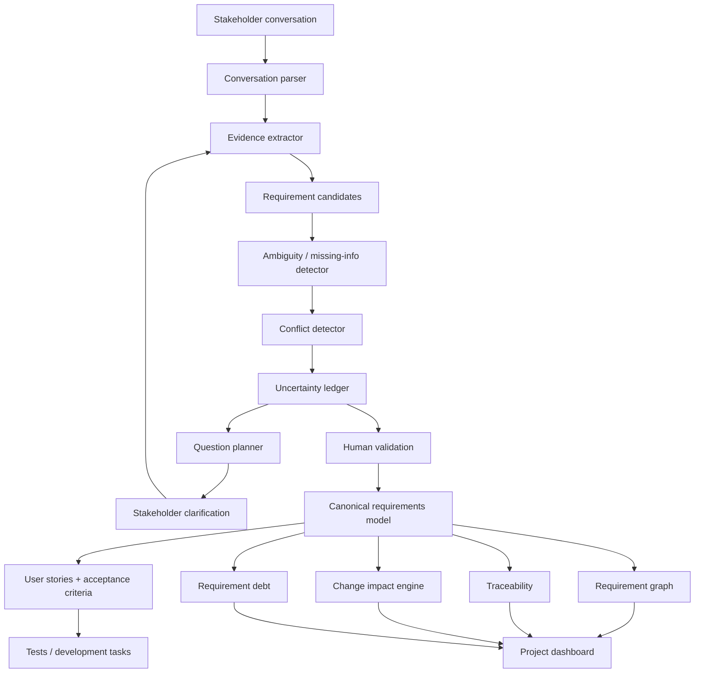

# RequirementPilot
## Agentic, Evidence-Grounded Requirements Engineering for Real Stakeholder Conversations

> **Project reference document — research + product + implementation blueprint**
>
> **Research snapshot:** 30 September 2026
>
> **Status:** Graduation / Internship Project Reference
>
> **Working title:** RequirementPilot
>
> **Core idea:** Build an AI requirements engineer that does not merely generate requirements from a prompt. It conducts a structured stakeholder interview, identifies missing/ambiguous/conflicting information, preserves evidence and decisions, turns validated information into a living requirements model, and propagates approved changes through downstream artifacts.

---

## 0. Important positioning decision

The original idea of a generic **"AI Requirements Engineer"** is no longer sufficiently novel by itself. Research and commercial systems already cover requirement extraction, user-story generation, acceptance-criteria generation, conversational elicitation, latent requirement discovery, conflict detection, change-impact analysis, requirements-to-code traceability, and multi-agent requirements/architecture workflows.

Therefore, this project must **not** be presented as:

> "An LLM that converts stakeholder text into requirements."

The project should instead be positioned as:

> **"A human-in-the-loop, evidence-grounded, change-aware requirements engineering system that actively interviews stakeholders, manages uncertainty and conflicts, and maintains a traceable requirements lifecycle."**

The strongest differentiating direction is not one isolated feature. It is the **integration of several RE controls into one living, auditable system**, plus a focused research contribution around **question selection, evidence/provenance, uncertainty, and Arabic/Egyptian-Arabic mixed-language requirements elicitation**.

**Novelty warning:** this document deliberately does **not** claim that every proposed feature is globally unprecedented. The literature is changing extremely quickly. The novelty statements below mean that, in the sources searched for this project, an **exact combination or exact implementation was not found**. Before submitting a paper or claiming "first," perform a final systematic search and citation check.

---

# 1. Executive Summary

## 1.1 The problem

Real stakeholders rarely provide clean software requirements.

A stakeholder may say:

> "عايز العميل يقدر يلغي الأوردر، بس بعد ما السواق يتحرك الموضوع يختلف، ولو المشكلة من عندنا الفلوس لازم ترجعله. وكمان المدير يشوف كل حاجة."

This single statement contains multiple requirement candidates, exceptions, an undefined policy boundary, an actor distinction, and an implied business rule.

A conventional LLM can immediately generate polished user stories. That is dangerous because the polished language can hide missing information rather than solve it.

The real requirements-engineering problem is:

1. identify what was actually stated;
2. distinguish explicit needs from inferred possibilities;
3. detect missing information;
4. detect ambiguous language;
5. detect conflicts between requirements or stakeholders;
6. ask the next question that provides the most useful clarification;
7. preserve source evidence and rationale;
8. transform validated answers into structured requirements;
9. connect requirements to acceptance criteria, tests, design artifacts and implementation tasks;
10. detect downstream impact when a requirement changes;
11. maintain a history of what changed, why, who approved it, and what remains unresolved.

---

# 2. What existing research already covers

The project was benchmarked against recent research through September 2026.

## 2.1 RECOVER — requirements from stakeholder conversations

**RECOVER (Requirements EliCitation frOm conVERsations)** analyzes stakeholder conversations and automatically extracts system requirements. It evaluates both turn-level identification and conversation-level synthesis, including correctness, completeness and actionability. The work appeared in *IEEE Transactions on Software Engineering* and was also presented at ICSE 2026.

Key implication for this project:

> "I analyze stakeholder conversations and generate requirements" is already known.

Source:
- IEEE / institutional record: https://doi.org/10.1109/TSE.2025.3572056
- arXiv: https://arxiv.org/abs/2411.19552
- ICSE 2026: https://conf.researchr.org/details/icse-2026/icse-2026-journal-first-papers/71/RECOVER-Toward-Requirements-Generation-from-Stakeholders-Conversations

---

## 2.2 LENS — latent requirements from stakeholder interviews

A June 2026 preprint, **LENS (LLM-Enabled Needs Discovery from Stakeholder Interviews)**, goes beyond explicit extraction. It analyzes interview transcripts and organizational context to infer **latent requirements** that stakeholders did not directly articulate. Each inferred requirement is accompanied by rationale and transcript traceability. The preliminary industrial evaluation used twelve cybersecurity-operations interviews and reported an average explicit-requirement F1 of 84.4%; 75% of latent requirements were rated by domain experts as having useful automation/time-saving potential.

Key implication:

> "We will discover hidden/implicit requirements from conversations" is no longer safe as the only novelty.

Source:
- arXiv: https://arxiv.org/abs/2606.25867

Important detail: LENS is especially relevant because it already uses an **explicit vs. latent requirement distinction**, organizational context, rationale generation, and source traceability.

---

## 2.3 OntoAgent — agentic requirements interview

A May 2026 paper, **From Chat to Interview: Agentic Requirements Elicitation with an Experience Ontology**, introduces OntoAgent. It argues that free-form LLM chat can miss implicit requirements and ask redundant questions. OntoAgent first induces an **experience ontology** from domain requirements and then uses operations called `ParseUser`, `ScoreOnto`, `ReRankOnto`, and `GatePrune` to select requirement concerns and generate interview questions.

The paper evaluates the approach on website-application requirements and reports a 33% improvement in IRE and 21% improvement in TKQR relative to the comparison baselines.

Key implication:

> "Our novelty is an agent that interviews the stakeholder instead of just chatting" is already being actively researched.

Source:
- arXiv: https://arxiv.org/abs/2605.05828

Related code/evaluation ecosystem:
- ReqElicitBench / ReqElicitGym: https://github.com/jdm4pku/ReqElicitBench

---

## 2.4 ReqElicitGym — evaluation of interview competence

The ReqElicitGym repository provides an interactive evaluation environment for conversational requirements elicitation. It contains 101 website requirements-elicitation scenarios across 10 application types, an LLM-based simulated stakeholder, a judge, conversation logs, and quantitative metrics.

Key implication:

> The project should not invent an evaluation strategy from scratch; it should build on established benchmark ideas while adding a new test dimension such as Arabic/Egyptian Arabic, evidence quality, or cross-artifact impact.

Source:
- GitHub: https://github.com/jdm4pku/ReqElicitBench

---

## 2.5 ProReFiCIA — requirements change-impact analysis

ProReFiCIA is an LLM-driven change-impact analysis approach published in 2026. It takes a natural-language change rationale and identifies the affected requirements. The final version reports 85.7% recall on an unseen industrial dataset while requiring review of only about 3.0% of requirements; adding domain knowledge through RAG raised recall to 95.8% while increasing the review share to about 3.4%.

Its workflow includes prompt optimization, model/prompt selection, refinement, filtering, and domain-knowledge augmentation.

Key implication:

> "Our system tells which requirements are affected when one requirement changes" is also already a standalone research contribution.

Source:
- arXiv HTML: https://arxiv.org/html/2511.00262v6
- arXiv record: https://arxiv.org/abs/2511.00262

---

## 2.6 Arabic requirements conflict detection — AraREQ

AraREQ, published at LREC 2026, provides a large Arabic dataset for requirements conflict detection and resolution. It contains roughly 27K Arabic requirement pairs, benchmarks four state-of-the-art LLMs in zero-shot and few-shot settings, and provides an end-to-end conflict detection and resolution system with code/data.

Key implication:

> "We will make requirements conflict detection in Arabic" is now a documented research line.

Source:
- ACL Anthology: https://aclanthology.org/2026.lrec-1.553/
- Resources: https://sina.birzeit.edu/ArReqConflicts/

---

## 2.7 Arabic ambiguity detection is not new either

Arabic requirements elicitation and ambiguity have been studied well before the current LLM wave. A 2013 paper introduced an interactive Arabic Requirements Elicitation Assistance System, and later research studied practices for avoiding ambiguity in Arabic software requirements. A 2024 study explicitly investigated ambiguity detection in Arabic requirement documents with machine learning.

Sources:
- 2013 AREAS paper: https://www.researchgate.net/publication/279235045_An_Interactive_System_for_Arabic_Software_Requirements_Elicitation
- Arabic ambiguity practices: https://www.earticle.net/Article/A280401
- 2024 ambiguity detection: https://www.sciencedirect.com/org/science/article/pii/S2156183424000044

Key implication:

The project should not claim simply:

> "Arabic requirements are under-researched."

A more defensible claim is:

> "Modern LLM-based, evidence-grounded, multi-turn requirements engineering for Egyptian Arabic / code-switched Arabic-English stakeholder conversations remains a focused opportunity, especially when evaluated end-to-end rather than on isolated classification tasks."

---

## 2.8 Requirements-to-code traceability is crowded

Recent work includes:

- LLM data augmentation for requirements traceability;
- HGTRTracer, which combines LLM reasoning and graph-based traceability;
- R2Code, a self-reflective LLM framework for requirements-to-code traceability;
- 2026 work combining LLM augmentation with advanced encoders;
- Code Gradients for tracing LLM-generated code back to requirements.

Sources:
- https://arxiv.org/abs/2509.20149
- https://doi.org/10.1109/apsec66846.2025.00070
- https://doi.org/10.48550/arXiv.2604.22432
- https://www.sciencedirect.com/science/article/pii/S0950584926000340
- https://ieeexplore.ieee.org/abstract/document/10628471

Therefore, a simple "requirement → code link" feature is not enough.

---

## 2.9 Multi-agent architecture from requirements is already active

MAAD (Multi-Agent Architecture Design), introduced in 2026, uses four agents — Analyst, Modeler, Designer and Evaluator — plus RAG and hierarchical memory to transform requirements into architecture blueprints. It evaluates architecture completeness, modularity, traceability and quality attributes.

Sources:
- arXiv: https://arxiv.org/abs/2606.01385
- replication package: https://github.com/RuiyinL/MAAD

Therefore, the project should not claim novelty merely by adding multiple agents.

---

## 2.10 Multi-agent stakeholder negotiation is also emerging

MedNegotiator, published in 2026, applies persona-driven generative AI agents, utility functions, Nash bargaining and safety guards to requirements negotiation in healthcare.

Source:
- https://www.sciencedirect.com/science/article/pii/S2590005626001062

This means that "multiple agents negotiate requirements" is not untouched territory. A differentiated implementation would need a different research question or context.

---

# 3. What the literature suggests is still worth building

After comparing these lines of work, the project should aim at **integration + measurable engineering controls**, not another isolated generator.

The strongest project identity is:

> **RequirementPilot is an evidence-first, change-aware, human-in-the-loop requirements operating system for ambiguous stakeholder conversations.**

The system treats a requirement as a living engineering object, not as a sentence generated by an LLM.

---

# 4. Proposed novelty contributions

The following are **candidate novelty contributions**, ordered from the most central to optional.

## N1 — Evidence-first Requirement Objects

Every requirement in the system must contain provenance and evidence metadata.

A requirement should never exist as only:

```text
REQ-017: The customer can cancel an order before dispatch.
```

Instead, it should be modeled as:

```json
{
  "id": "REQ-017",
  "statement": "The customer can cancel an order before dispatch.",
  "type": "functional",
  "status": "proposed",
  "source_spans": ["conversation_12", "turn_38"],
  "evidence_level": "explicit",
  "evidence_text": "...",
  "speaker": "customer",
  "stakeholder_role": "customer",
  "rationale": "...",
  "assumptions": [],
  "ambiguities": [],
  "confidence": 0.96,
  "validated_by": null,
  "approval_status": "pending",
  "created_by": "elicitation_agent",
  "created_at": "...",
  "version": 1
}
```

### Why this matters

It creates a distinction between:

- what the stakeholder explicitly said;
- what the system inferred;
- what the analyst proposed;
- what a stakeholder validated;
- what remains uncertain.

The system must never silently convert an inference into an official requirement.

### Candidate research question

> Does explicit evidence classification and provenance reduce hallucinated or unsupported requirements compared with conventional LLM-only requirements generation?

---

# 5. N2 — Adaptive Question Selection using uncertainty + information gain + impact

OntoAgent already uses ontology-guided question selection. The project can go in a different direction by treating the interview as an **active uncertainty-reduction problem**.

At each turn, the system maintains a set of unresolved requirement uncertainties:

```text
U1: Who can cancel an order?
U2: When can cancellation occur?
U3: Is refund automatic?
U4: What exceptions exist?
U5: What happens if payment already settled?
```

Each candidate question gets a utility score:

```text
Question Utility =
    Information Gain
  × Requirement Impact
  × Ambiguity Reduction
  × Downstream Risk
  - User Effort
  - Redundancy
```

The question is not simply "What sounds reasonable?"

It is:

> "Which unanswered question will remove the most uncertainty from the requirements model while causing the least stakeholder burden?"

Expected information gain is an established concept for asking informative questions in LLM systems, so the novelty here should be the **requirements-engineering objective function and downstream impact weighting**, not the information-gain concept itself.

Relevant general research:
- https://aclanthology.org/2024.findings-emnlp.291/

Relevant requirements interview work:
- https://arxiv.org/abs/2605.05828

---

# 6. N3 — Ambiguity branching with behavioral divergence

This is one of the most promising technical directions.

Suppose the stakeholder says:

> "The manager can approve requests quickly."

The system identifies possible interpretations:

```text
Interpretation A:
Manager can approve directly.

Interpretation B:
Manager approval is conditional on department.

Interpretation C:
Manager approval means two-step approval.
```

Instead of asking a generic question, the system generates a small **interpretation branch set**.

For each branch, it constructs the expected downstream behavior:

```text
A → one approval state
B → approval + department policy
C → approval + second reviewer
```

Then it asks:

> "Do you mean A, B, or C?"

Or it asks a more natural question that separates the branches.

This direction is related to ClarifyGPT and recent ambiguity-aware software engineering research, but the project can make the contribution specifically about **requirements-model branching and downstream behavioral divergence before implementation**.

Related sources:
- ClarifyGPT: https://arxiv.org/abs/2310.10996
- Orchid ambiguous-requirement benchmark: https://arxiv.org/abs/2604.21505

---

# 7. N4 — A Requirement Uncertainty Ledger

Create a first-class object called a **Requirement Uncertainty Ledger**.

Every requirement may carry:

```text
certainty_state:
    confirmed
    likely
    inferred
    ambiguous
    conflicting
    blocked
    obsolete
```

And:

```text
uncertainty_reasons:
    missing_actor
    missing_condition
    vague_quantity
    undefined_term
    conflicting_stakeholders
    missing_exception
    missing_nfr
    unsupported_inference
```

The product would show something like:

```text
Project Health
--------------------------
Confirmed:        31
Likely:            8
Inferred:         12
Ambiguous:         5
Conflicting:       2
Blocked:           3

High-risk uncertainty: 4
```

This converts "the project still has unclear requirements" into a measurable engineering artifact.

Requirements uncertainty is a well-established topic, but a focused **LLM-era uncertainty ledger connected to evidence, downstream risk, and active questioning** was not identified in the specific LLM requirements sources reviewed for this project.

Background:
- https://www.sciencedirect.com/science/article/pii/S2666307421000218

---

# 8. N5 — Requirement Debt as a continuously calculated metric

Requirements Engineering Debt is an existing concept. The novelty should therefore not be "requirements debt exists."

Instead, define an operational **Requirement Debt Score** over the project's live model.

Example:

```text
Debt(REQ) =
    ambiguity_weight
  + missing_evidence_weight
  + unresolved_conflict_weight
  + untested_weight
  + stale_dependency_weight
  + unapproved_inference_weight
```

Then calculate:

```text
Project Requirement Debt
├── Ambiguity debt
├── Evidence debt
├── Conflict debt
├── Traceability debt
├── Validation debt
└── Staleness debt
```

The dashboard can show:

```text
REQ-021
Requirement Debt: HIGH
Reason:
- no explicit source confirmation
- references undefined "urgent"
- affects 4 downstream tests
- conflicts with REQ-033
```

Background:
- https://arxiv.org/abs/1907.10887
- https://doi.org/10.1016/j.infsof.2023.107201
- 2025 exploration using LLMs/IDP for requirements debt: https://www.sciencedirect.com/science/article/pii/S1877050925025657

---

# 9. N6 — Stakeholder Voice Preservation

This is a strong product-level differentiator.

Most requirement pipelines collapse all stakeholder statements into one document. The system should preserve **who wanted what, why, and whether the final requirement reflects or modifies that position**.

Example:

```text
Stakeholder A — Customer Support
Wants: cancellation allowed after assignment
Reason: reduce complaints

Stakeholder B — Operations
Wants: cancellation blocked after dispatch
Reason: delivery cost

Stakeholder C — Finance
Wants: refund only when payment is captured
Reason: reconciliation constraints
```

The system creates:

```text
CONFLICT-004
A ↔ B
Topic: cancellation timing
Status: unresolved
Impact: refund workflow + dispatch workflow
```

After negotiation:

```text
Decision:
Cancellation allowed until driver departure.
Finance rule remains unchanged.
```

The final requirement links to **all original positions and the decision rationale**.

This is different from merely detecting conflicts because it maintains a **stakeholder-voice ledger** through the life of the requirement.

Caveat: stakeholder conflict resolution is a long-established RE topic, and multi-agent negotiation has now appeared in 2026. The proposed contribution is specifically the **provenance-preserving consolidation and lifecycle history**, not conflict detection itself.

---

# 10. N7 — Egyptian Arabic / Arabic-English Code-Switching Requirements Benchmark

This should be one of the project's strongest empirical contributions.

Do not simply add an Arabic UI.

Create a benchmark where stakeholders communicate in realistic mixtures such as:

```text
"عايز الadmin يقدر approve الـrequest لو الـmanager وافق،
بس لو الـrequest urgent لازم يبقى فيه escalation."
```

Include:

- Egyptian Arabic;
- Modern Standard Arabic;
- Arabic-English code switching;
- technical English terms;
- abbreviations;
- colloquial omission;
- vague quantities;
- implied actors;
- ambiguous references;
- contradictory stakeholder statements.

Then annotate each conversation with:

```text
explicit requirements
latent candidates
ambiguities
missing information
conflicts
actors
constraints
NFR hints
source spans
resolution status
```

The exact benchmark described above was not found in the sources reviewed. Existing Arabic requirements work is primarily MSA/text/document oriented, including AraREQ, while historical work already established Arabic requirements elicitation and ambiguity research.

This makes the **benchmark itself** a potentially publishable contribution.

---

# 11. N8 — End-to-end change propagation from conversation to downstream artifacts

A particularly strong integration idea is:

```text
Stakeholder says:
"السقف يبقى 5,000 بدل 2,000"
```

The system identifies that this modifies:

```text
REQ-012
 ↓
Business Rule BR-004
 ↓
User Story US-008
 ↓
Acceptance Criteria AC-008-03
 ↓
Test TC-021
 ↓
API constraint POST /orders
 ↓
Database validation
 ↓
Implementation Task DEV-044
```

This should result in a visual **impact propagation graph**.

ProReFiCIA already studies impact among requirements, so your differentiator should be the **cross-artifact, provenance-aware propagation inside the project created by your own requirements lifecycle**.

Do not claim this has never been studied at all; requirements-to-code traceability and change impact are active research areas.

---

# 12. N9 — Requirements "time travel"

A useful product feature:

> "Show me what we knew and why we made this decision at version 3."

For each requirement:

```text
v1 — inferred from conversation
v2 — stakeholder clarified actor
v3 — finance conflict resolved
v4 — acceptance criterion added
v5 — changed by product owner
```

And the user can compare:

```text
Before
vs
After

Why changed?
Who requested it?
What evidence supported it?
What downstream artifacts changed?
Which tests became invalid?
```

This builds an **auditability layer** rather than a simple document generator.

---

# 13. N10 — "Explain why you asked me this question"

Every AI interview question can have hidden structured rationale:

```text
Question:
"Can a manager approve a request after it expires?"

Reason:
- detected missing expiration behavior
- affects REQ-012 and REQ-014
- currently three valid interpretations exist
- expected downstream impact = high
- high expected information gain
```

The stakeholder sees only a concise explanation when needed, while the system stores the full reasoning metadata.

This is valuable for trust and academic evaluation:

> Can transparent question rationales increase stakeholder acceptance of AI-driven elicitation?

---

# 14. Recommended final project scope

The project should not attempt everything on day one.

## Phase A — Core research prototype

Build:

1. conversational stakeholder interface;
2. requirement extraction;
3. evidence/provenance;
4. ambiguity detection;
5. uncertainty ledger;
6. adaptive question selection;
7. requirement graph;
8. stakeholder approval;
9. user-story + acceptance-criteria generation;
10. evaluation benchmark.

## Phase B — Strong differentiators

Add:

11. stakeholder conflict ledger;
12. change-impact analysis;
13. cross-artifact traceability;
14. requirement debt dashboard;
15. Arabic/Egyptian-Arabic mode.

## Phase C — Advanced extension

Add:

16. architecture impact;
17. test generation;
18. code-task generation;
19. MCP/IDE integration;
20. voice interview interface.

---

# 15. Formal problem statement

## 15.1 Input

The system receives one or more of:

- live stakeholder messages;
- interview transcripts;
- uploaded meeting transcripts;
- existing SRS documents;
- issue tickets;
- product briefs;
- policy/regulation documents;
- organizational context;
- existing requirements;
- existing architecture metadata;
- previous project decisions.

## 15.2 Output

The system produces a continuously maintained requirements model containing:

- functional requirements;
- non-functional requirements;
- business rules;
- actors;
- constraints;
- assumptions;
- ambiguities;
- conflicts;
- evidence links;
- priorities;
- dependencies;
- user stories;
- acceptance criteria;
- tests;
- trace links;
- change-impact reports;
- decisions;
- uncertainty status.

## 15.3 Human role

The system is **assistive**, not autonomous authority.

Humans must be able to:

- approve;
- reject;
- edit;
- merge;
- split;
- override;
- resolve conflicts;
- mark evidence as authoritative;
- close ambiguities.

An AI-generated requirement should enter the official baseline only after explicit human acceptance.

---

# 16. Product workflow



---

# 17. System architecture

## 17.1 High-level architecture

```text
┌─────────────────────────────────────────────────────────────┐
│                        FRONTEND                             │
│ Next.js / React                                            │
│                                                             │
│  Chat  |  Requirements  |  Graph  |  Conflicts             │
│  Traceability | Changes | Debt | Decision History          │
└─────────────────────────┬───────────────────────────────────┘
                          │
                          ▼
┌─────────────────────────────────────────────────────────────┐
│                       API LAYER                             │
│ FastAPI                                                     │
│ Auth / Projects / Sessions / Requirements / Decisions       │
└─────────────────────────┬───────────────────────────────────┘
                          │
                          ▼
┌─────────────────────────────────────────────────────────────┐
│                     ORCHESTRATOR                           │
│ Agent state + workflow engine                               │
│                                                             │
│  Interview Agent                                             │
│  Evidence Agent                                              │
│  Ambiguity Agent                                             │
│  Conflict Agent                                              │
│  Question Planner                                            │
│  Quality Agent                                               │
│  Traceability Agent                                          │
│  Change Impact Agent                                         │
└───────────────┬────────────────────┬────────────────────────┘
                │                    │
                ▼                    ▼
      ┌──────────────────┐  ┌─────────────────────┐
      │ LLM Gateway      │  │ Retrieval / Tools   │
      │ model-agnostic   │  │ vector search       │
      └──────────────────┘  │ project context     │
                            │ KB / policies       │
                            └──────────┬──────────┘
                                       │
                                       ▼
┌─────────────────────────────────────────────────────────────┐
│                         DATA LAYER                           │
│                                                             │
│ PostgreSQL + pgvector                                       │
│                                                             │
│ requirements / evidence / conversations / decisions         │
│ dependencies / stakeholder views / artifacts / evaluations  │
└─────────────────────────────────────────────────────────────┘
```

---

# 18. Recommended technical stack

## Backend

- Python
- FastAPI
- Pydantic
- SQLAlchemy
- PostgreSQL
- pgvector
- Alembic
- Redis for short-lived state/cache if needed

## LLM layer

Build a model-agnostic adapter:

```python
class LLMProvider:
    async def generate(self, messages, schema=None):
        ...
```

Possible providers can be changed without touching business logic.

Do not hard-code the entire application around one model.

## Agent orchestration

Start with a simple explicit state machine instead of adding a heavy agent framework immediately.

Use a graph/state abstraction:

```text
ConversationState
    ↓
EvidenceState
    ↓
RequirementState
    ↓
UncertaintyState
    ↓
QuestionState
    ↓
ValidationState
```

A framework can be introduced later only if it genuinely reduces complexity.

## Database

Use PostgreSQL first.

Use `pgvector` for semantic retrieval.

Add Neo4j only if graph query complexity actually becomes a bottleneck. A relational schema plus explicit dependency tables is sufficient for the MVP.

## Frontend

- Next.js
- React
- TypeScript
- Tailwind CSS
- React Flow for requirement/traceability graphs
- Monaco only if code artifacts are added

## Deployment

Possible baseline:

```text
Frontend → Vercel / similar
Backend  → Docker container
DB       → managed PostgreSQL
Worker   → background task service
```

For a university demo, a single Docker Compose environment is enough.

---

# 19. Core data model

The database should model requirements as durable objects.

## 19.1 Main entities

```text
Project
Conversation
ConversationTurn
Stakeholder
Requirement
Evidence
Ambiguity
Conflict
Question
QuestionCandidate
Decision
Assumption
Dependency
Artifact
TraceLink
ChangeRequest
ImpactRecord
Validation
RequirementVersion
RequirementDebtRecord
EvaluationRun
MetricResult
```

---

# 20. Requirement schema

```json
{
  "id": "REQ-0017",
  "project_id": "PRJ-001",
  "version": 3,
  "statement": "The customer may cancel an order before driver departure.",
  "type": "functional",
  "actor": "customer",
  "goal": "cancel order",
  "conditions": [
    "driver has not departed"
  ],
  "exceptions": [],
  "priority": "high",
  "status": "validated",
  "evidence_level": "explicit",
  "source_evidence_ids": ["EVID-38"],
  "stakeholder_ids": ["ST-07"],
  "ambiguity_ids": [],
  "conflict_ids": [],
  "assumption_ids": [],
  "depends_on": [],
  "impacts": ["US-008", "AC-008-03", "TC-021"],
  "confidence": 0.98,
  "human_validated": true,
  "created_by": "interview_agent",
  "approved_by": "ST-07",
  "created_at": "2026-09-30T20:00:00Z",
  "updated_at": "2026-09-30T20:15:00Z"
}
```

---

# 21. Evidence object

Evidence is first-class.

```json
{
  "id": "EVID-38",
  "type": "conversation_span",
  "source_id": "TURN-038",
  "speaker": "customer",
  "text": "لو السواق لسه ما اتحركش العميل يقدر يلغي",
  "normalized_text": "If the driver has not departed, the customer can cancel.",
  "timestamp": "00:17:42",
  "evidence_level": "explicit",
  "confidence": 0.99
}
```

For an inferred requirement:

```json
{
  "evidence_level": "latent",
  "source_evidence_ids": ["EVID-52", "EVID-53"],
  "inference_rationale": "Repeated manual reconciliation described by finance stakeholder.",
  "requires_validation": true
}
```

---

# 22. Evidence levels

Use an explicit controlled vocabulary:

```text
EXPLICIT
    Directly stated by a stakeholder.

PARAPHRASED
    Restatement with no semantic change.

DERIVED
    Logically derived from explicit requirements.

LATENT
    Plausible opportunity inferred from workflow/context.

ASSUMED
    Introduced to close a gap temporarily.

MODEL_PROPOSED
    Proposed by the AI or analyst without stakeholder evidence.

VALIDATED
    Explicitly approved by an authorized stakeholder.

REJECTED
    Explicitly rejected.
```

Never use `validated` as a synonym for `generated`.

---

# 23. Interview engine

The interview engine is the center of the product.

## 23.1 State maintained after every turn

```text
Known requirements
Unknowns
Ambiguities
Conflicts
Assumptions
Stakeholder positions
Open questions
Candidate questions
Requirement dependencies
Risk
Coverage
```

## 23.2 Question generation pipeline

```text
Current state
    ↓
Generate candidate unresolved issues
    ↓
Generate 3–10 candidate questions
    ↓
Estimate each question's utility
    ↓
Remove redundant questions
    ↓
Check stakeholder burden
    ↓
Select top question
    ↓
Ask
    ↓
Update model
```

---

# 24. Question utility formula

Start with a transparent heuristic.

```text
QScore(q) =
    α * InformationGain(q)
  + β * ImpactReduction(q)
  + γ * AmbiguityReduction(q)
  + δ * ConflictResolutionValue(q)
  + ε * CoverageGain(q)
  - ζ * UserEffort(q)
  - η * Redundancy(q)
```

Then normalize every component to `[0,1]`.

Suggested initial weights for an experiment:

```text
α = 0.25
β = 0.25
γ = 0.20
δ = 0.15
ε = 0.10
ζ = 0.03
η = 0.02
```

Do not treat these values as ground truth. They are starting points for an ablation study.

Experiments should compare:

```text
Baseline A: LLM chooses question
Baseline B: random eligible question
Baseline C: ontology-guided question selection
Proposed: impact-aware information-gain selection
```

---

# 25. Why downstream impact should affect the next question

Example:

```text
Unknown U1:
What happens after payment failure?

Unknown U2:
What color should the notification button be?
```

Even if both are unresolved, U1 affects:

```text
payment flow
order state
refund logic
notifications
tests
analytics
```

U2 affects one UI detail.

Therefore, question selection should account for **dependency fan-out**, not just semantic relevance.

This is a concrete researchable idea.

---

# 26. Ambiguity detector

The detector should classify ambiguity by type.

```text
LEXICAL
    "active"

REFERENTIAL
    "it", "they", "this"

SCOPE
    "all users except..."

NUMERIC
    "fast", "soon", "large"

TEMPORAL
    "before", "after", "recently"

ACTOR
    unclear responsible party

CONDITIONAL
    unclear if/when rule applies

POLICY
    rule boundary not specified

EXCEPTION
    exception behavior missing

VAGUENESS
    subjective terms

COMPLETENESS
    required field/behavior omitted
```

For each ambiguity:

```json
{
  "type": "temporal",
  "text_span": "before dispatch",
  "interpretations": [
    "before driver assigned",
    "before driver departs",
    "before vehicle reaches pickup point"
  ],
  "affected_requirements": ["REQ-021"],
  "risk": "high"
}
```

---

# 27. Conflict detection

Do not rely only on semantic similarity.

Use a three-level approach:

### Level 1 — lexical/semantic screening

Retrieve candidate requirement pairs using embeddings.

### Level 2 — LLM relation classifier

Classify:

```text
ENTAILS
CONTRADICTS
DEPENDS_ON
REFINES
OVERLAPS
UNRELATED
```

### Level 3 — rule-aware validation

Use deterministic checks for obvious domain constraints.

Example:

```text
REQ-A:
User can cancel after dispatch.

REQ-B:
Cancellation is forbidden after dispatch.
```

This should produce a conflict with evidence from both requirements.

For Arabic conflict detection, AraREQ is a useful external benchmark and baseline.

---

# 28. Stakeholder conflict ledger

Create:

```text
CONFLICT-001

Topic:
Cancellation policy

Stakeholder A:
Customer Support
Position:
Cancellation allowed after assignment.

Stakeholder B:
Operations
Position:
Cancellation blocked after dispatch.

Stakeholder C:
Finance
Position:
Refund depends on payment capture.

Status:
OPEN

Decision required:
Yes

Impact:
High
```

After a decision:

```text
Decision D-014

Decision:
Cancellation allowed until driver departure.

Rationale:
Operations cost remains controlled while support can offer cancellation.

Approved by:
Product Owner
Operations Lead
Finance Lead
```

The conflict remains in history; the project does not pretend the disagreement never existed.

---

# 29. Requirement graph

The core graph can be represented as:

```text
Stakeholder
   │ states
   ▼
Evidence
   │ supports
   ▼
Requirement
   │
   ├── refines → Requirement
   ├── conflicts_with → Requirement
   ├── depends_on → Requirement
   ├── justified_by → Decision
   ├── constrained_by → BusinessRule
   ├── realized_as → UserStory
   ├── verified_by → Test
   ├── implemented_by → Task/Code
   └── impacted_by → ChangeRequest
```

This turns the requirements repository into an actual **knowledge graph**.

---

# 30. Cross-artifact traceability

Recommended first version:

```text
Evidence
  ↓
Requirement
  ↓
User Story
  ↓
Acceptance Criteria
  ↓
Test Case
  ↓
Development Task
```

Optional later:

```text
Development Task
  ↓
Pull Request
  ↓
Code Symbol
  ↓
Deployment
```

Each edge should include:

```text
link_type
confidence
created_by
source
created_at
last_verified
```

---

# 31. Change impact engine

User enters:

> "الحد الأقصى للطلب يبقى 5000 بدل 2000."

System classifies change:

```text
MODIFICATION
```

Then searches:

```text
semantic dependencies
explicit dependencies
data constraints
acceptance criteria
tests
API constraints
implementation tasks
```

Output:

```text
CHANGE-019

Direct impact:
REQ-014

Indirect impact:
REQ-015
REQ-020
US-008
AC-008-02
TC-021

Potential stale artifacts:
API-03
validation rule
pricing test

Human review required:
4 artifacts
```

The system should **not auto-apply** the change to official artifacts.

---

# 32. Requirement debt engine

Calculate a score at requirement level.

Suggested formula:

```text
DebtScore =
  20 * ambiguity
+ 15 * missing_evidence
+ 15 * unresolved_conflict
+ 10 * missing_acceptance_criteria
+ 10 * missing_tests
+ 10 * stale_traceability
+ 10 * unresolved_assumptions
+ 10 * age_without_review
```

Normalize to `0–100`.

Interpretation:

```text
0–19    Low
20–39   Moderate
40–59   Significant
60–79   High
80–100  Critical
```

These thresholds are engineering choices for the prototype, not scientifically established constants. Validate or calibrate them with users.

---

# 33. Human-in-the-loop approval policy

This should be explicit in both the product and thesis.

### AI can

- extract;
- propose;
- classify;
- detect;
- summarize;
- rank questions;
- suggest conflict resolutions;
- estimate impact;
- generate downstream drafts.

### AI cannot silently

- approve a requirement;
- resolve a stakeholder conflict;
- mark an inference as explicit;
- delete historical evidence;
- rewrite an approved baseline without audit history;
- treat a hallucinated requirement as stakeholder intent.

---

# 34. Prompt architecture

Do not build the whole system from one gigantic system prompt.

Each agent should have a narrow contract.

## 34.1 Evidence extraction prompt contract

Input:

```text
conversation turns
project context
```

Output:

```json
{
  "evidence": [
    {
      "span_id": "...",
      "statement": "...",
      "speaker": "...",
      "evidence_type": "explicit|constraint|pain_point|assumption|decision"
    }
  ]
}
```

Rule:

> Do not infer unstated capabilities in this stage.

---

# 35. Requirement formulation prompt contract

Input:

```text
approved evidence spans
```

Output:

```json
{
  "requirements": [
    {
      "statement": "...",
      "type": "FR|NFR|business_rule|constraint",
      "source_span_ids": ["..."],
      "assumptions": [],
      "needs_validation": true
    }
  ]
}
```

Rule:

> Do not introduce a fact that cannot be traced to source evidence or a clearly labeled assumption.

---

# 36. Question planner prompt contract

The LLM should not directly output one final question.

First produce candidates:

```json
{
  "questions": [
    {
      "question": "...",
      "targets": ["AMB-03", "REQ-08"],
      "expected_information_gain": 0.81,
      "impact_reduction": 0.72,
      "effort": 0.20,
      "redundancy": 0.05
    }
  ]
}
```

Then use deterministic scoring to choose the final question.

This makes the selection process experimentally measurable.

---

# 37. Why deterministic post-processing matters

Many recent requirements papers show a recurring pattern:

```text
LLM generation
      ↓
structured post-processing
      ↓
validation
```

ProReFiCIA, for example, combines prompting with refinement and filtering rather than trusting one raw output. Formal-requirements research also emphasizes coupling LLM flexibility with deterministic/formal validation.

Relevant source:
- https://doi.org/10.1016/j.infsof.2025.107697

The project should follow this design principle:

> **LLM proposes; deterministic logic verifies wherever possible.**

---

# 38. Formal validation rules

Examples:

```text
Rule R1:
Every validated requirement must have >= 1 evidence source or an explicitly accepted assumption.

Rule R2:
Every acceptance criterion must reference a requirement.

Rule R3:
Every high-priority functional requirement must have >= 1 acceptance criterion.

Rule R4:
Every open conflict must have a status.

Rule R5:
A latent requirement cannot become validated without human approval.

Rule R6:
A changed requirement must invalidate or re-check affected downstream artifacts.

Rule R7:
A superseded requirement remains queryable historically.

Rule R8:
A requirement cannot be deleted if downstream artifacts depend on it; it must be superseded or archived.
```

---

# 39. Evaluation strategy

This is where the project becomes a serious research project.

Do not evaluate the system using only:

> "It looked good in the demo."

Use quantitative evaluation.

---

# 40. Research Questions

## RQ1 — Extraction

> How accurately can the system identify explicit software requirements from stakeholder conversations?

Metrics:

- precision
- recall
- F1

---

## RQ2 — Question effectiveness

> Does impact-aware adaptive question selection retrieve more missing requirements with fewer interview turns than baseline question-selection strategies?

Metrics:

- requirement coverage;
- turns to coverage threshold;
- average questions per requirement;
- redundant-question rate;
- stakeholder effort;
- implicit-requirement recall.

---

## RQ3 — Evidence reliability

> Does provenance-first generation reduce unsupported requirement generation?

Metrics:

- evidence precision;
- evidence recall;
- unsupported requirement rate;
- hallucination rate;
- citation/source-span correctness.

---

## RQ4 — Ambiguity resolution

> Does behavioral-branching ambiguity analysis identify and resolve ambiguous requirements more effectively than LLM-only clarification?

Metrics:

- ambiguity detection F1;
- ambiguity resolution accuracy;
- number of valid interpretations remaining after clarification;
- downstream behavioral divergence.

---

## RQ5 — Conflict management

> Can the system identify and maintain unresolved stakeholder conflicts without collapsing distinct stakeholder positions into one unsupported requirement?

Metrics:

- conflict detection F1;
- stakeholder-position preservation accuracy;
- false resolution rate;
- decision provenance completeness.

---

## RQ6 — Change propagation

> Can an evidence-grounded requirements graph identify downstream artifacts impacted by approved requirement changes?

Metrics:

- impact recall;
- impact precision;
- stale-artifact detection rate;
- trace-link validity.

---

## RQ7 — Arabic/code-switched performance

> How does performance change across English, MSA, Egyptian Arabic, and Arabic-English code-switched stakeholder conversations?

Metrics:

- extraction F1;
- ambiguity F1;
- conflict F1;
- question quality;
- evidence-link correctness;
- user satisfaction.

---

# 41. Baselines

At minimum compare:

```text
B1 — single-shot LLM requirement generation
B2 — conversational LLM with unrestricted questioning
B3 — ontology-guided interview baseline inspired by OntoAgent
B4 — proposed impact-aware question planner
```

For artifact validation:

```text
B5 — LLM-only conflict detection
B6 — embedding retrieval + LLM classification
B7 — LLM + deterministic validator
```

Do not compare only different models. Compare different **system strategies**.

---

# 42. Dataset strategy

Use several levels.

## Level 1 — Public requirements documents

Use PURE as a foundational requirements source.

PURE contains 79 public requirements documents and 34,268 sentences.

Source:
- https://zenodo.org/records/7118517

Also consider:
- PROMISE requirements dataset;
- public software requirements repositories;
- SWARD and related labeled requirements datasets;
- public user stories / issue datasets where licensing permits.

---

## Level 2 — Requirements interview cases

ReqElicitBench/ReqElicitGym already provides 101 website requirements-elicitation scenarios and a simulated stakeholder environment.

Use it for:

- baseline replication;
- interviewer evaluation;
- regression testing.

Source:
- https://github.com/jdm4pku/ReqElicitBench

---

## Level 3 — Create your own controlled interview benchmark

This should be the project's main dataset contribution.

Target:

```text
100–200 scenarios
```

Each scenario should contain:

```text
project description
stakeholder role
initial request
hidden requirements
ambiguities
conflicts
NFRs
business rules
expected clarification paths
final validated requirement set
```

---

# 43. How to construct your benchmark safely

Do not fabricate a benchmark and call it "real industry data."

Use three tracks.

### Track A — Public-source derived

Start from public requirements documents and deliberately create incomplete initial descriptions while retaining a hidden gold specification.

### Track B — Expert-designed scenarios

Ask software engineers, product people or instructors to design stakeholder scenarios.

### Track C — Real anonymized conversations

Only with permission.

Remove:

- names;
- emails;
- customer information;
- internal company names;
- credentials;
- proprietary business data.

Document the anonymization process.

---

# 44. Benchmark record format

```json
{
  "scenario_id": "REQP-047",
  "domain": "delivery",
  "language": "egyptian_arabic_code_switched",
  "stakeholders": [
    "customer",
    "operations_manager",
    "finance_manager"
  ],
  "initial_message": "...",
  "gold_requirements": [],
  "hidden_requirements": [],
  "ambiguities": [],
  "conflicts": [],
  "expected_questions": [],
  "acceptable_question_variants": [],
  "gold_decisions": [],
  "downstream_artifacts": []
}
```

---

# 45. Synthetic stakeholder simulator

For scalable testing, create an Oracle Stakeholder Agent.

The oracle knows:

```text
hidden requirements
persona
domain knowledge
acceptable answers
forbidden assumptions
```

The interviewer interacts with it as if it were a stakeholder.

But synthetic evaluation must not be the only evaluation because both the interviewer and oracle may share the same model biases.

Use human evaluation on a smaller subset.

---

# 46. Human evaluation protocol

Recruit:

- software students for basic usability;
- developers;
- product/requirements practitioners if possible.

For each conversation, ask reviewers to rate:

```text
Requirement correctness
Requirement completeness
Question relevance
Question redundancy
Evidence correctness
Ambiguity detection
Conflict handling
Trustworthiness
Overall usefulness
```

Use a 5-point Likert scale plus binary factual checks.

---

# 47. Arabic benchmark design

Create matched scenarios:

```text
Version A: English
Version B: Modern Standard Arabic
Version C: Egyptian Arabic
Version D: Egyptian Arabic + English technical terminology
```

Keep the underlying gold requirements identical.

Then evaluate:

```text
Cross-language consistency

Does the system extract the same underlying requirement?
Does it preserve conditions?
Does it preserve exceptions?
Does it preserve actor identity?
Does it introduce extra assumptions?
```

This is much stronger than saying "our chatbot supports Arabic."

---

# 48. Example benchmark case

## Initial conversation

```text
Stakeholder:
"إحنا عندنا app للdelivery. العميل بيعمل order، والـdriver بياخد الطلب. عايزين العميل يقدر يلغي لو حصلت مشكلة."
```

### Candidate system output

```text
REQ-001
Customer can cancel an order.
Evidence: explicit
Status: needs clarification

Open ambiguity:
What counts as "problem"?
```

### Bad question

> "Can you provide more details?"

### Better candidate questions

```text
1. Can the customer cancel at any time, or only before the driver starts delivery?
2. If the restaurant has already started preparing the order, is cancellation still allowed?
3. Should cancellation be allowed when the driver is already traveling to the customer?
```

The question planner should choose the question with the highest downstream value.

---

# 49. Latent requirement handling

Latent requirements must be labeled differently.

Example:

Stakeholder says:

> "إحنا كل يوم بنقعد ساعتين نجمع أرقام الأداء من كذا system."

The system may infer:

```text
LATENT-CANDIDATE-01
The system could automatically consolidate performance metrics.
```

But it must not write:

> "The system shall automatically consolidate performance metrics."

until the stakeholder validates it.

This is a central safety property of the system.

---

# 50. Requirement lifecycle

Use:

```text
DISCOVERED
   ↓
DRAFT
   ↓
NEEDS_CLARIFICATION
   ↓
PROPOSED
   ↓
STAKEHOLDER_REVIEW
   ↓
VALIDATED
   ↓
BASELINED
   ↓
IMPLEMENTED
   ↓
VERIFIED
   ↓
SUPERSEDED / RETIRED
```

For conflicts:

```text
OPEN → UNDER_DISCUSSION → DECISION_PENDING → RESOLVED / REJECTED
```

For assumptions:

```text
PROPOSED → ACCEPTED / REJECTED / EXPIRED
```

---

# 51. Requirements versioning

Never overwrite a requirement.

Use event-style history:

```text
REQ-014 v1
"Customer can cancel order."

REQ-014 v2
"Customer can cancel before dispatch."

REQ-014 v3
"Customer can cancel before driver departure; refund depends on payment state."
```

Each version stores:

- author;
- source;
- reason;
- timestamp;
- approval;
- impacted artifacts.

---

# 52. Decision record

A decision should contain:

```json
{
  "id": "DEC-014",
  "question": "When is cancellation allowed?",
  "options": [
    "before assignment",
    "before departure",
    "before pickup"
  ],
  "selected": "before departure",
  "rationale": "Balances support flexibility and operational cost.",
  "stakeholders": ["operations", "support", "finance"],
  "evidence": ["EVID-44", "EVID-46"],
  "approved_by": ["ST-02", "ST-05"],
  "status": "accepted"
}
```

---

# 53. The project dashboard

Main dashboard should answer:

### What do we know?

```text
Validated requirements: 31
Draft: 8
Open ambiguity: 5
Open conflicts: 2
```

### What is risky?

```text
High-risk requirements: 4
High requirement debt: 7
Missing evidence: 6
```

### What changed?

```text
12 changes this week
4 downstream impact reviews pending
```

### What remains unresolved?

```text
Question Q-021
Question Q-024
Conflict C-003
Assumption A-008
```

---

# 54. Requirement detail page

For each requirement display:

```text
REQ-014
------------------------------------
Statement
Type
Priority
Status
Evidence level
Confidence

Why does it exist?
[rationale]

Evidence
[conversation snippets]

Stakeholders
[positions]

Ambiguities
[open/closed]

Conflicts
[linked]

Assumptions
[linked]

Downstream artifacts
[user story]
[acceptance criteria]
[tests]
[tasks]

Version history
v1 → v2 → v3

Impact map
[graph]
```

---

# 55. Graph UI

Use React Flow.

Color by relationship state only if a visual distinction is useful.

Example graph:

```text
Stakeholder
    |
    v
Evidence ----> Requirement <---- Conflict
                  |
          +-------+--------+
          |       |        |
          v       v        v
      Story      Test    Business Rule
          |
          v
        Task
```

Clicking an edge should show why the link exists.

---

# 56. Explainability design

Do not expose hidden chain-of-thought.

Instead, provide structured evidence-oriented explanations:

```text
Why was this requirement created?
→ Derived from turns 18 and 21.

Why is it marked ambiguous?
→ "urgent" has three plausible operational meanings.

Why was this question chosen?
→ It affects 4 downstream requirements and resolves 2 open ambiguities.
```

This is useful without depending on hidden reasoning disclosure.

---

# 57. Security and privacy

The system may process highly sensitive business conversations.

Implement:

- project-level access control;
- role-based permissions;
- encrypted secrets;
- environment variables;
- audit logging;
- data deletion;
- configurable model provider;
- no API key storage in prompts/logs;
- redaction pipeline for evaluation datasets.

Never train a public model on private project conversations without explicit authorization.

---

# 58. Hallucination controls

Use multiple controls.

## Control 1
Evidence required.

## Control 2
Explicit/latent distinction.

## Control 3
Human approval.

## Control 4
Structured JSON outputs.

## Control 5
Deterministic validation.

## Control 6
Cross-agent verifier.

## Control 7
Source-span linking.

## Control 8
No silent modification of baselined requirements.

---

# 59. Agent design

Recommended agents:

## Agent 1 — Interviewer

Purpose:
- conduct conversation;
- ask next question.

## Agent 2 — Evidence Extractor

Purpose:
- extract explicit evidence;
- identify pain points;
- identify stated constraints.

## Agent 3 — Requirement Analyst

Purpose:
- convert validated evidence into canonical requirements.

## Agent 4 — Ambiguity Analyst

Purpose:
- detect missing information;
- generate interpretations.

## Agent 5 — Conflict Analyst

Purpose:
- compare requirements/stakeholders.

## Agent 6 — Question Planner

Purpose:
- generate/rank clarifying questions.

## Agent 7 — Quality Checker

Purpose:
- validate quality criteria;
- detect unsupported statements.

## Agent 8 — Traceability Agent

Purpose:
- maintain links between artifacts.

## Agent 9 — Change Impact Agent

Purpose:
- analyze proposed changes.

## Agent 10 — Report Agent

Purpose:
- produce SRS / report / summary.

You do **not** need all 10 as separate physical services. They are logical responsibilities. Combine them initially into 3–5 service components.

---

# 60. Recommended MVP agent topology

For a student project, begin with:

```text
Supervisor / Orchestrator
        |
        +---- Interview + Question Planner
        |
        +---- Requirement + Evidence Analyst
        |
        +---- Validation / Conflict / Ambiguity Checker
        |
        +---- Traceability + Change Impact Worker
```

Then split services only after metrics show that specialization helps.

---

# 61. RAG design

RAG should be used for **project context**, not as a buzzword.

Retrieve:

- project glossary;
- company/domain terminology;
- existing requirements;
- existing policies;
- previous decisions;
- product constraints;
- architecture facts;
- approved business rules.

Do not retrieve:

- irrelevant generic web pages;
- unsupported assumptions;
- previous drafts as if they were authoritative.

Every retrieved item should carry:

```text
source_id
version
authority
created_at
status
```

---

# 62. Authority-aware retrieval

A major improvement over naive RAG:

Rank sources by authority.

Example:

```text
Approved policy       authority = 1.00
Signed decision       authority = 0.95
Validated requirement = 0.95
Official specification= 0.90
Stakeholder statement = 0.85
Draft analyst note    = 0.60
AI inference          = 0.30
General web knowledge = 0.10
```

These are prototype values, not universal truths.

The model must not allow low-authority evidence to silently override a high-authority approved decision.

---

# 63. Glossary engine

Stakeholder language creates terminology drift.

Example:

```text
"driver"
"courier"
"delivery guy"
"مندوب"
```

The system should identify that these may refer to the same concept — but only merge them after sufficient evidence.

Glossary entry:

```json
{
  "canonical_term": "driver",
  "aliases": ["courier", "delivery guy", "مندوب"],
  "confidence": 0.92,
  "status": "candidate"
}
```

This supports Arabic-English code switching.

---

# 64. Non-functional requirements

The system must not focus only on functional requirements.

Look for NFR clues such as:

```text
"لازم يفتح بسرعة"
→ performance

"محدش يشوف البيانات دي"
→ confidentiality / access control

"لازم يشتغل حتى لو النت فصل ويرجع يكمل"
→ availability / resilience

"عايزه يدعم 10,000 مستخدم"
→ scalability

"لازم نقدر نراجع مين غير إيه"
→ auditability
```

Convert vague NFRs into clarification questions.

Example:

> "عايزه سريع"

Ask:

> "ما الحد المقبول لزمن الاستجابة في الحالة الأساسية؟ هل نستهدف أقل من 2 ثانية مثلًا؟"

Do not invent 2 seconds as the official requirement; present it as a candidate target for confirmation.

---

# 65. Requirements quality model

Use quality dimensions:

```text
Correctness
Completeness
Consistency
Unambiguity
Verifiability
Traceability
Atomicity
Feasibility
Priority clarity
Source support
Stakeholder validation
```

A requirement quality report could say:

```text
REQ-014

Correctness:        0.96
Completeness:       0.71
Consistency:        0.89
Verifiability:      0.55
Evidence support:   1.00
Validation:         YES

Main problem:
Refund condition is still undefined.
```

The scores are advisory and should be calibrated with human judgments.

---

# 66. Quality evaluation without ground truth

A 2026 methodology paper highlights a core issue: RE outputs are often free-form and do not have simple ground truth.

Therefore, use a combination of:

- ground-truth datasets when available;
- human expert assessment;
- structured criteria;
- pairwise comparison;
- deterministic checks;
- downstream task success.

Source:
- https://www.mdpi.com/2079-8954/14/6/598

---

# 67. Pairwise evaluation

Instead of asking:

> "Is output good?"

Compare:

```text
System A
System B
```

and ask:

- which extracted more requirements correctly?
- which asked fewer redundant questions?
- which preserved evidence better?
- which created fewer unsupported assumptions?

This reduces some absolute-rating noise.

---

# 68. Ablation studies

At least these:

```text
Ablation 1
Remove evidence tracking.

Ablation 2
Remove impact from question scoring.

Ablation 3
Remove ambiguity branching.

Ablation 4
Remove RAG.

Ablation 5
Remove stakeholder voice preservation.
```

Then compare changes in:

```text
coverage
question count
unsupported requirements
conflicts detected
impact recall
user satisfaction
```

This gives your project a real research dimension.

---

# 69. Proposed paper-level contributions

A strong final paper could present:

### Contribution C1
An evidence-grounded architecture for human-in-the-loop LLM requirements engineering.

### Contribution C2
An adaptive question planner combining information gain, requirement impact and ambiguity reduction.

### Contribution C3
A provenance-preserving requirements lifecycle graph with change-aware propagation.

### Contribution C4
An Egyptian-Arabic / Arabic-English code-switching requirements benchmark.

### Contribution C5
An empirical evaluation comparing LLM-only, ontology-guided, and impact-aware interview strategies.

Do not claim "first" until the final literature review confirms it.

---

# 70. Strong novelty configurations

The project can be presented in several ways.

## Configuration A — Language research

```text
Egyptian Arabic Requirements Engineering
+
Code-switching
+
Evidence
+
Ambiguity
+
Benchmark
```

Best if you want NLP/language research.

## Configuration B — Agent research

```text
Adaptive Requirements Interview Agent
+
Information Gain
+
Downstream Impact
+
Uncertainty Ledger
```

Best if you want Agentic AI.

## Configuration C — SE systems research

```text
Living Requirements Graph
+
Provenance
+
Traceability
+
Change Impact
+
Requirement Debt
```

Best if you want Software Engineering + AI.

## Configuration D — Full project

```text
Agentic Interview
+
Evidence
+
Ambiguity
+
Conflicts
+
Arabic
+
Traceability
+
Change Impact
```

This is the full vision; implementation should be phased.

---

# 71. Recommended project title variants

### Academic
**Evidence-Grounded Agentic Requirements Engineering for Ambiguous Stakeholder Conversations**

### Product-oriented
**RequirementPilot — An AI Requirements Engineering Copilot**

### Research-oriented
**Impact-Aware Conversational Requirements Elicitation with Evidence and Traceability**

### Arabic-focused
**Egyptian Arabic Agentic Requirements Engineering with Evidence-Grounded Clarification**

### Full-system
**RequirementPilot: A Human-in-the-Loop, Evidence-Grounded and Change-Aware Requirements Engineering Platform**

---

# 72. Product tagline

> **From vague conversations to validated, traceable requirements.**

Alternative:

> **Don't let the LLM guess the requirement. Let it ask for the missing one.**

---

# 73. Demo storyline

Your final demo should tell one story rather than show random features.

## Step 1
Stakeholder starts in Egyptian Arabic.

```text
"عايز system للطلبات..."
```

## Step 2
The AI extracts explicit requirements.

## Step 3
It detects three ambiguities.

## Step 4
It asks a high-value clarification question.

## Step 5
Stakeholder answers.

## Step 6
The requirement graph updates.

## Step 7
Another stakeholder introduces a conflicting rule.

## Step 8
Conflict ledger appears.

## Step 9
Stakeholders resolve it.

## Step 10
The system generates:

- validated requirements;
- user stories;
- acceptance criteria;
- test cases.

## Step 11
You modify one requirement.

## Step 12
The system displays the impact graph.

## Step 13
The project dashboard shows requirement debt decreasing after validation.

This single storyline demonstrates the entire thesis.

---

# 74. Example complete scenario

## Initial stakeholder statement

```text
"احنا عايزين customers يقدروا cancel orders لو في مشكلة،
والmanager يقدر يعمل approve، والnotifications لازم توصل بسرعة.
ولو order urgent لازم يتعامل بطريقة مختلفة."
```

## System extraction

```text
REQ-001
Customers can cancel orders.

REQ-002
Managers can approve orders.

NFR-001
Notifications should be delivered quickly.

BR-001
Urgent orders follow a different handling process.
```

## Ambiguities

```text
AMB-001
"لو في مشكلة" undefined.

AMB-002
"بسرعة" undefined.

AMB-003
"urgent" undefined.

AMB-004
"different handling" undefined.
```

## Candidate questions

```text
Q1:
What events make an order eligible for cancellation?

Q2:
What response/delivery time is acceptable for notifications?

Q3:
What defines an urgent order?
```

The question planner may choose Q3 if urgent orders affect many downstream requirements.

Stakeholder:

```text
"أي order فوق 1000 جنيه أو عليه express delivery يعتبر urgent."
```

Now:

```text
BR-001 becomes precise.
```

Then another stakeholder says:

```text
"لا، الـexpress delivery لوحده مش urgent."
```

System:

```text
CONFLICT-002
```

No auto-resolution.

After agreement:

```text
Urgent = order value > 1000 EGP OR express delivery selected.
```

Then the system generates acceptance criteria and a test suite.

Finally:

```text
Change request:
Threshold changes from 1000 → 1500 EGP.
```

Impact graph:

```text
BR-001
 ↓
REQ-004
 ↓
US-010
 ↓
AC-010-01
 ↓
TC-033
 ↓
DEV-021
```

---

# 75. Implementation phases

## Phase 0 — Research setup

Deliverables:

- literature matrix;
- problem statement;
- requirements ontology/schema;
- benchmark protocol;
- baseline definitions.

Duration target: 1–2 weeks.

---

## Phase 1 — Backend foundation

Build:

- project model;
- conversations;
- stakeholder model;
- PostgreSQL schema;
- API;
- LLM abstraction.

Duration target: 2–3 weeks.

---

## Phase 2 — Evidence + extraction

Build:

- turn parser;
- evidence object;
- requirement candidate extraction;
- explicit/latent classification.

Duration target: 2–3 weeks.

---

## Phase 3 — Interview engine

Build:

- ambiguity detector;
- question candidate generation;
- question utility scoring;
- iterative state update.

Duration target: 3–4 weeks.

---

## Phase 4 — Requirement validation

Build:

- requirement quality checks;
- stakeholder approval;
- conflicts;
- decisions;
- assumptions.

Duration target: 2–3 weeks.

---

## Phase 5 — Traceability graph

Build:

- requirements → stories;
- stories → acceptance criteria;
- criteria → tests;
- dependency graph;
- visual graph.

Duration target: 2–3 weeks.

---

## Phase 6 — Change impact

Build:

- change request parser;
- affected artifact retrieval;
- impact ranking;
- review workflow;
- version diff.

Duration target: 3 weeks.

---

## Phase 7 — Arabic research track

Build:

- Egyptian Arabic prompt/evaluation suite;
- code-switching normalization;
- benchmark;
- cross-language comparison.

Duration target: 3–4 weeks.

---

## Phase 8 — Research evaluation

Run:

- baselines;
- ablations;
- human evaluation;
- error analysis;
- performance/cost analysis.

Duration target: 3–4 weeks.

---

# 76. Suggested 6-month timeline

```text
Month 1
Literature + architecture + schema + baseline

Month 2
Conversation + evidence + requirement extraction

Month 3
Adaptive interview + ambiguity + uncertainty

Month 4
Conflict + decisions + traceability graph

Month 5
Change impact + Arabic benchmark + evaluation

Month 6
Experiments + documentation + deployment + presentation
```

---

# 77. Team division for 4 people

## Member 1 — LLM / Interview Agent

- prompts;
- question planner;
- ambiguity;
- model evaluation.

## Member 2 — NLP / Arabic + Dataset

- Egyptian Arabic benchmark;
- annotations;
- language evaluation;
- normalization.

## Member 3 — Backend / Data / Graph

- API;
- database;
- graph;
- traceability;
- change impact.

## Member 4 — Frontend / QA / DevOps

- dashboard;
- interview UI;
- graph UI;
- testing;
- deployment.

All members contribute to experiments and documentation.

---

# 78. Engineering directory structure

```text
requirementpilot/
│
├── apps/
│   ├── web/
│   │   ├── app/
│   │   ├── components/
│   │   ├── features/
│   │   └── lib/
│   │
│   └── api/
│       ├── app/
│       │   ├── api/
│       │   ├── core/
│       │   ├── models/
│       │   ├── schemas/
│       │   ├── services/
│       │   ├── agents/
│       │   ├── retrieval/
│       │   └── workflows/
│       └── tests/
│
├── data/
│   ├── raw/
│   ├── processed/
│   ├── annotations/
│   └── evaluation/
│
├── research/
│   ├── literature/
│   ├── baselines/
│   ├── experiments/
│   ├── ablations/
│   └── results/
│
├── prompts/
│   ├── evidence/
│   ├── requirement/
│   ├── ambiguity/
│   ├── conflict/
│   ├── interview/
│   ├── traceability/
│   └── impact/
│
├── docs/
│   ├── architecture.md
│   ├── data-model.md
│   ├── evaluation.md
│   ├── api.md
│   └── research.md
│
├── infra/
│   ├── docker/
│   └── deployment/
│
└── README.md
```

---

# 79. API design

Suggested endpoints:

```text
POST /projects
GET  /projects/{id}

POST /projects/{id}/stakeholders
POST /projects/{id}/conversations
POST /conversations/{id}/turns

POST /sessions/{id}/analyze-turn
POST /sessions/{id}/next-question
POST /sessions/{id}/finalize

GET  /projects/{id}/requirements
POST /requirements
PATCH /requirements/{id}
POST /requirements/{id}/validate
POST /requirements/{id}/supersede

GET  /requirements/{id}/evidence
GET  /requirements/{id}/impact
GET  /requirements/{id}/history

GET  /projects/{id}/conflicts
POST /conflicts/{id}/resolve

GET  /projects/{id}/decisions
POST /decisions

POST /projects/{id}/change-analysis

GET /projects/{id}/traceability
GET /projects/{id}/debt

POST /evaluation/runs
GET  /evaluation/runs/{id}
```

---

# 80. Unit testing

Test deterministic components heavily.

Examples:

```text
Question score calculation
Graph edge creation
Requirement versioning
Conflict status transitions
Evidence validation
Authority ranking
Debt score
Impact propagation
```

Use LLM tests separately:

```text
prompt regression tests
JSON validity tests
language tests
hallucination tests
adversarial ambiguity tests
```

---

# 81. Adversarial test suite

Create deliberate traps.

### Trap 1 — unsupported inference

Stakeholder never mentions refunds.

Model should not invent refund requirements.

### Trap 2 — ambiguous actor

"They can approve the request."

Who is "they"?

### Trap 3 — contradiction

One stakeholder says 5,000.
Another says 2,000.

### Trap 4 — stale decision

Requirement v5 contradicts an old decision v2 that was explicitly superseded.

### Trap 5 — terminology confusion

"manager" vs "admin" vs "supervisor".

### Trap 6 — mixed language

Egyptian Arabic + English technical vocabulary.

### Trap 7 — hidden exception

"Users can delete files" except for archived records.

### Trap 8 — vague non-functional requirement

"The system should be very fast."

---

# 82. Cost/latency optimization

The architecture must minimize LLM calls.

Do not call a large model for every tiny deterministic check.

Recommended:

```text
Embedding model
→ retrieval

Small/local model
→ classification / extraction where adequate

Strong LLM
→ hard reasoning / synthesis

Deterministic code
→ validation / scoring / state transitions
```

Cache:

- project context;
- glossary;
- requirement summaries;
- immutable approved artifacts.

This also makes the research cost measurable.

---

# 83. Model evaluation matrix

Evaluate models as interchangeable components.

Columns:

```text
Model
Language
Reasoning
Structured output
Latency
Cost
JSON reliability
Requirement F1
Ambiguity F1
Conflict F1
Question quality
```

Do not choose a model because a benchmark or leaderboard labels it "best." Test it on your own RE workload.

---

# 84. Baseline report template

For each baseline report:

```text
Model:
System strategy:
Prompt version:
Temperature:
Context window:
Dataset:
# scenarios:

Extraction precision:
Extraction recall:
Extraction F1:

Question coverage:
Turns to 80% coverage:
Redundancy:

Unsupported requirements:

Ambiguity F1:
Conflict F1:

Latency:
Cost:
```

---

# 85. Error taxonomy

Every experiment needs an error taxonomy.

```text
E1 Unsupported requirement
E2 Missing requirement
E3 Wrong actor
E4 Wrong condition
E5 Wrong exception
E6 Wrong priority
E7 Missed ambiguity
E8 False ambiguity
E9 Missed conflict
E10 False conflict
E11 Wrong evidence span
E12 Wrong stakeholder attribution
E13 Invalid downstream trace
E14 Missed impact
E15 False impact
E16 Stale artifact not detected
E17 Redundant question
E18 Low-information question
E19 Overly technical question
E20 Incorrect Arabic interpretation
```

This turns debugging into research evidence.

---

# 86. What not to build early

Avoid these until the core system works:

- voice calls;
- full autonomous coding;
- enterprise SSO;
- complicated Kubernetes deployment;
- fine-tuning large LLMs;
- many vector databases;
- fully autonomous agent swarms;
- generalized architecture generation;
- huge web scraping pipelines.

The project's differentiator is **requirements intelligence**, not infrastructure complexity.

---

# 87. What makes the project strong for an AI Engineer profile

The project demonstrates:

```text
LLMs
RAG
Structured generation
Agent orchestration
Evaluation
NLP
Information retrieval
Knowledge graphs
PostgreSQL
API engineering
Human-in-the-loop systems
Observability
MLOps-style experimentation
```

It also demonstrates something many LLM demos do not:

> **control over model output instead of blind dependence on generation.**

---

# 88. What makes it strong for Software Engineering faculty

The project clearly maps to:

- Requirements Engineering;
- Software Architecture;
- Database Design;
- Testing;
- Distributed Systems;
- NLP;
- Human-Computer Interaction;
- Software Maintenance.

The requirements model and evaluation framework provide a strong academic backbone.

---

# 89. What makes it strong for a startup/demo

The user-facing value proposition is simple:

> "Your stakeholders do not know how to write requirements. RequirementPilot interviews them, finds what's missing, and keeps the project requirements consistent as things change."

Target customers:

- software houses;
- freelancers/agencies;
- startups;
- product teams;
- internal IT departments;
- system integrators.

Potential integrations later:

- Jira;
- GitHub;
- GitLab;
- Linear;
- Notion;
- Slack/Teams;
- MCP tools;
- IDEs.

---

# 90. Example integrations

## Jira

Requirement validated → create Epic/Story.

## GitHub

Requirement change → open review issue for impacted implementation tasks.

## Slack/Teams

Meeting transcript → create evidence and review queue.

## Notion

Publish validated SRS and decision log.

## MCP

Expose requirement graph and change-impact tools to other AI agents.

---

# 91. MCP extension

A future MCP server can expose tools such as:

```text
get_requirement(id)
search_requirements(query)
get_requirement_evidence(id)
get_open_ambiguities(project)
get_open_conflicts(project)
get_requirement_impact(id)
get_project_decisions(project)
validate_requirement(id)
create_change_request(text)
```

This would allow coding agents to query the approved requirements system instead of relying on stale copied prompts.

The MCP layer should enforce authority and permissions.

---

# 92. A future coding-agent workflow

```text
Developer agent asks:
"Implement cancellation logic."

RequirementPilot returns:

REQ-014
Validated behavior:
- allowed before driver departure
- refund policy depends on payment state
- manager approval not required

Evidence:
EVID-38
DEC-014

Tests:
TC-021
TC-022
TC-023
```

Then the coding agent has a **single source of truth**.

This is a powerful long-term product direction.

---

# 93. Key research gap statement

Use wording like this in your thesis draft:

> Existing LLM-based requirements engineering approaches increasingly support requirement extraction from stakeholder conversations, latent need discovery, interview guidance, conflict detection, and change-impact analysis as separate tasks. However, there remains practical value in unifying these capabilities into a provenance-preserving, human-in-the-loop requirements lifecycle in which evidence, uncertainty, stakeholder positions, validation decisions, and downstream impacts remain explicitly linked. The project therefore investigates an integrated requirements engineering workflow rather than a standalone text generation task.

This is safer and more defensible than claiming that no prior work exists.

---

# 94. Strong research hypothesis

> A requirements interview agent that selects questions using a combination of information gain, requirement dependency impact, ambiguity reduction, and unresolved stakeholder conflict will achieve higher requirement coverage with fewer interview turns than generic LLM questioning and existing ontology-only baselines.

Secondary hypothesis:

> Evidence-first requirement modeling will reduce unsupported requirement generation and improve human reviewers' trust in generated requirements.

Arabic hypothesis:

> Explicit handling of Egyptian Arabic and Arabic-English code switching will reduce extraction and ambiguity-resolution errors relative to English-only or translate-then-process pipelines.

---

# 95. Experimental matrix

```text
                    Interview Strategy
                ┌────────┬────────┬────────────┐
                │ LLM    │ Ontology│ Proposed   │
                ├────────┼────────┼────────────┤
English         │   ✓    │   ✓    │     ✓      │
MSA             │   ✓    │   ✓    │     ✓      │
Egyptian Arabic │   ✓    │   ✓    │     ✓      │
Code-switched   │   ✓    │   ✓    │     ✓      │
                └────────┴────────┴────────────┘
```

Then measure:

```text
Coverage
Turns
Redundancy
Ambiguity resolution
Evidence correctness
Stakeholder trust
```

---

# 96. Minimum viable research contribution

If time becomes limited, protect these three things:

## Must-have 1
Adaptive interview/question selection.

## Must-have 2
Evidence-grounded requirements with explicit/latent/assumption states.

## Must-have 3
A benchmark + rigorous evaluation.

Everything else can be scaled down.

---

# 97. Minimum viable product

The absolute MVP is:

```text
User opens project
        ↓
Starts stakeholder conversation
        ↓
System extracts requirements
        ↓
System identifies missing info
        ↓
System asks one next question
        ↓
User answers
        ↓
Requirement becomes clearer
        ↓
User validates
        ↓
Dashboard shows:
    requirement
    evidence
    ambiguity
    confidence
```

No graph, no code generation, no voice required for MVP.

---

# 98. Graduation-grade version

```text
MVP
+
Adaptive question utility
+
Stakeholder conflict ledger
+
Requirement graph
+
Traceability
+
Change impact
+
Requirement debt
+
Arabic/code-switching benchmark
+
Human evaluation
```

---

# 99. Outstanding risks

## Risk 1 — Scope explosion

Mitigation: freeze MVP and research questions before adding integrations.

## Risk 2 — LLM cost

Mitigation: model abstraction, caching, small-model classification, deterministic validators.

## Risk 3 — Synthetic benchmark bias

Mitigation: include public data + expert scenarios + human-reviewed subset.

## Risk 4 — Novelty challenge

Mitigation: document a dated literature search, use conservative novelty claims, release benchmark/code where licensing permits.

## Risk 5 — "Agent swarm" without measurable benefit

Mitigation: every agent must have a measurable responsibility.

## Risk 6 — Arabic claims too broad

Mitigation: define exact dialect/task/benchmark instead of saying "Arabic support."

## Risk 7 — Hallucination

Mitigation: evidence-first design and human approval.

---

# 100. Literature search log to maintain during the project

Create a spreadsheet or JSON file with:

```text
paper
year
venue
problem
data
method
LLM?
agent?
conversation?
ambiguity?
conflict?
traceability?
change impact?
Arabic?
benchmark?
open code?
closest to our project?
gap
```

Update it every time a related paper appears.

This is essential because the field is moving quickly; for example, several relevant papers discussed in this document were published or substantially revised in 2026.

---

# 101. Closest-work matrix

| Work | Conversation | Interview | Latent | Arabic | Conflict | Change Impact | Traceability | Multi-agent | Your exact combination |
|---|---:|---:|---:|---:|---:|---:|---:|---:|---:|
| RECOVER | ✓ | partial | limited | ✗ | ✗ | ✗ | ✓ | ✗ | No |
| LENS | ✓ | input transcript | ✓ | ✗ | ✗ | ✗ | ✓ | ✗ | No |
| OntoAgent | ✓ | ✓ | implicit target | ✗ | ✗ | ✗ | limited | agent | No |
| AraREQ | ✗ | ✗ | ✗ | ✓ | ✓ | ✗ | limited | ✗ | No |
| ProReFiCIA | ✗ | ✗ | ✗ | ✗ | ✗ | ✓ | ✓ | ✗ | No |
| MedNegotiator | ✓/domain | ✓ | ✗ | ✗ | ✓ | ✗ | limited | ✓ | No |
| MAAD | requirement input | ✗ | ✗ | ✗ | limited | ✓/architecture | ✓ | ✓ | No |
| RequirementPilot | ✓ | ✓ | ✓ | ✓ | ✓ | ✓ | ✓ | logical agents | **Target combination** |

The matrix is a conceptual comparison, not a claim that each existing paper lacks every listed feature; read original sources before writing a final literature review.

---

# 102. Most defensible differentiator

If you need one sentence for a supervisor:

> **The system does not use an LLM to write requirements; it uses an LLM to conduct and control the requirements-engineering process while keeping every requirement tied to evidence, uncertainty, stakeholder decisions, and downstream impact.**

---

# 103. Most defensible research novelty statement

> **The proposed contribution is an integrated, evidence-first and change-aware conversational requirements engineering workflow, with an impact-aware question-selection mechanism and a multilingual/codeswitched evaluation track.**

Notice the phrase:

> **proposed contribution**

instead of:

> **first-ever system**.

Use the stronger claim only after a final systematic literature review.

---

# 104. What to tell the supervisor

Suggested explanation:

```text
The project addresses the gap between vague stakeholder conversations
and validated software requirements.

Instead of directly generating requirements, the system behaves like a
requirements engineer: it identifies explicit evidence, discovers gaps,
detects ambiguities and conflicts, chooses clarification questions based
on expected information value and downstream impact, and maintains a
versioned requirement graph.

Every requirement remains linked to its evidence, stakeholder source,
assumptions, validation decision, and downstream artifacts.

The research contribution is evaluated through controlled baselines,
ablations, human evaluation, and a benchmark that includes Egyptian
Arabic and Arabic-English code-switching.
```

---

# 105. Final implementation priorities

## Priority 1
Canonical requirement + evidence schema.

## Priority 2
Conversation state machine.

## Priority 3
Requirement extraction.

## Priority 4
Ambiguity detector.

## Priority 5
Adaptive question ranking.

## Priority 6
Human approval.

## Priority 7
Conflict/decision ledger.

## Priority 8
Traceability graph.

## Priority 9
Change impact.

## Priority 10
Arabic benchmark + research evaluation.

---

# 106. Final checklist before coding

### Research

- [ ] Literature matrix created.
- [ ] Closest papers downloaded.
- [ ] Baselines defined.
- [ ] Research questions frozen.
- [ ] Novelty claims written conservatively.

### Data

- [ ] Dataset licenses checked.
- [ ] Public sources documented.
- [ ] Annotation schema frozen.
- [ ] Arabic guidelines written.
- [ ] Human-review protocol prepared.

### Engineering

- [ ] Database schema designed.
- [ ] Requirement versioning implemented.
- [ ] Evidence model implemented.
- [ ] Audit log implemented.
- [ ] LLM abstraction implemented.
- [ ] Structured outputs validated.

### AI

- [ ] Prompts versioned.
- [ ] Model settings recorded.
- [ ] Retrieval evaluated.
- [ ] Error taxonomy defined.
- [ ] Ablation plan ready.

### Product

- [ ] Interview screen.
- [ ] Requirement detail.
- [ ] Conflict view.
- [ ] Decision history.
- [ ] Graph view.
- [ ] Impact view.
- [ ] Debt view.

---

# 107. References

## Core requirements engineering / LLM references

1. RECOVER — Toward Requirements Generation From Stakeholders' Conversations
   - https://doi.org/10.1109/TSE.2025.3572056
   - https://arxiv.org/abs/2411.19552

2. LENS — LLM-Based Discovery of Latent Requirements from Stakeholder Conversations
   - https://arxiv.org/abs/2606.25867

3. OntoAgent — From Chat to Interview: Agentic Requirements Elicitation with an Experience Ontology
   - https://arxiv.org/abs/2605.05828

4. ReqElicitGym benchmark
   - https://github.com/jdm4pku/ReqElicitBench

5. ProReFiCIA — LLM-Driven Cost-Effective Requirements Change Impact Analysis
   - https://arxiv.org/html/2511.00262v6
   - https://arxiv.org/abs/2511.00262

6. AraREQ — Arabic requirements conflict detection and resolution
   - https://aclanthology.org/2026.lrec-1.553/
   - https://sina.birzeit.edu/ArReqConflicts/

7. MAAD — Multi-Agent Architecture Design
   - https://arxiv.org/abs/2606.01385
   - https://github.com/RuiyinL/MAAD

8. MedNegotiator — multi-agent requirements negotiation in healthcare
   - https://www.sciencedirect.com/science/article/pii/S2590005626001062

9. Requirements traceability systematic literature review
   - https://doi.org/10.1145/3672608.3707952

10. ML approaches for automated software traceability — systematic review
    - https://www.sciencedirect.com/science/article/pii/S0164121225002043

11. LLM data augmentation for requirements traceability
    - https://arxiv.org/abs/2509.20149

12. R2Code — requirements-to-code traceability
    - https://doi.org/10.48550/arXiv.2604.22432

13. HGTRTracer — LLM-augmented requirements-to-code traceability
    - https://doi.org/10.1109/apsec66846.2025.00070

14. Requirements-to-code traceability + LLM augmentation, 2026
    - https://www.sciencedirect.com/science/article/pii/S0950584926000340

15. Requirements from developers' perspective in LLM-assisted software engineering
    - https://arxiv.org/abs/2507.07548
    - https://ieeexplore.ieee.org/abstract/document/11190385

16. ClarifyGPT
    - https://arxiv.org/abs/2310.10996

17. Orchid — ambiguity-aware code generation benchmark
    - https://arxiv.org/abs/2604.21505

18. Formal requirements engineering and LLMs: two-way roadmap
    - https://doi.org/10.1016/j.infsof.2025.107697

19. LLM evaluation methodology for Requirements Engineering without ground truth
    - https://www.mdpi.com/2079-8954/14/6/598

20. Learning to Ask Informative Questions with Expected Information Gain
    - https://aclanthology.org/2024.findings-emnlp.291/

## Datasets / resources

21. PURE public requirements documents
    - https://zenodo.org/records/7118517

22. Software Requirements Data Set
    - https://zenodo.org/records/7897601

23. PROMISE / public requirements resources overview via RE Open Data Initiative
    - https://conf.researchr.org/track/RE-2026/RE-2026-re-open-data-initiative

## Arabic requirements background

24. An Interactive System for Arabic Software Requirements Elicitation
    - https://www.researchgate.net/publication/279235045_An_Interactive_System_for_Arabic_Software_Requirements_Elicitation

25. Avoiding Ambiguities in Arabic Software User Requirements
    - https://www.earticle.net/Article/A280401

26. Detecting Ambiguities in Requirement Documents Written in Arabic Using Machine Learning Algorithms
    - https://www.sciencedirect.com/org/science/article/pii/S2156183424000044

## Requirements debt / uncertainty

27. Towards a Holistic Definition of Requirements Debt
    - https://arxiv.org/abs/1907.10887

28. An initial theory to understand and manage requirements engineering debt in practice
    - https://doi.org/10.1016/j.infsof.2023.107201

29. Requirements uncertainty
    - https://www.sciencedirect.com/science/article/pii/S2666307421000218

---

# 108. Final project definition

## Final name

**RequirementPilot**

## Final one-line definition

> **An evidence-grounded agentic requirements engineering platform that conducts stakeholder interviews, resolves uncertainty and conflicts, builds a traceable requirements graph, and analyzes the downstream impact of requirement changes.**

## Research core

```text
Adaptive requirements interview
+
Evidence/provenance
+
Uncertainty management
+
Impact-aware question selection
+
Stakeholder conflict ledger
+
Change-aware traceability
+
Arabic/code-switched benchmark
```

## Product core

```text
Conversation
→ Requirements
→ Validation
→ Traceability
→ Change Impact
→ Decision History
```

---

# 109. The single most important rule for the project

> **Never let the LLM silently fill a requirements gap.**

When information is missing:

```text
Detect gap
   ↓
Represent uncertainty
   ↓
Ask a question
   ↓
Collect evidence
   ↓
Update requirement
   ↓
Request human validation
```

This principle should appear in:

- the architecture;
- the prompts;
- the database schema;
- the UI;
- the evaluation;
- the thesis;
- the final demo.

It is the conceptual backbone of RequirementPilot.

---

# 110. Final warning about novelty

The requirements engineering + LLM literature is moving unusually quickly. During the search for this document, multiple 2026 works appeared that directly overlapped with parts of the original project idea — including conversational elicitation, latent requirement discovery, Arabic conflict detection, change-impact analysis, multi-agent negotiation, and requirements-to-architecture generation.

Therefore:

**Do not write:**

> "No one has done this before."

Write:

> "Our literature review identifies prior work addressing individual capabilities, while our project investigates an integrated workflow combining evidence-grounded elicitation, impact-aware question selection, provenance-preserving requirements management, and multilingual/codeswitched evaluation."

That is a stronger academic position because it is defensible.

---

# 111. Next implementation milestone

The first concrete engineering milestone should be **Milestone M1: Evidence-Grounded Interview Core**.

M1 is complete when the system can:

```text
1. Start a project.
2. Start a stakeholder conversation.
3. Store every turn.
4. Extract explicit evidence.
5. Produce requirement candidates.
6. Link every candidate to evidence.
7. Mark each candidate as explicit / inferred / assumption.
8. Detect at least basic ambiguities.
9. Generate candidate clarification questions.
10. Rank them using a deterministic utility score.
11. Ask one question.
12. Update the requirement object.
13. Let a human validate it.
14. Preserve the entire history.
```

Everything else should be built on top of this core.

---

# End of reference document
